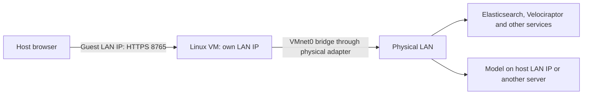

# Setup guide: model and connectors

This guide gets Mordecai working end to end:
- a model to run the agents;
- the connectors that give them data and reach (Security Onion, Elastic, Splunk, Velociraptor, MISP, OpenCTI, Archer);
- local forensic tools;
- the scope the action policy enforces.

Only a model is strictly required. Every connector is optional: enable the ones you have. The agents can only
use what is connected.

For a Linux VM on a Windows workstation, start with [section 0a: VMware Workstation Pro](#0a-linux-vm-with-vmware-workstation-pro).
That section also covers the equivalent network arrangement on macOS with VMware Fusion. To run it in WSL 2 on
the Windows PC itself, start with [section 0b: Windows with WSL 2](#0b-windows-with-wsl-2).

Run commands from the repository root. Use `.venv/bin/mordecai`, or activate the environment with
`source .venv/bin/activate` before examples that use bare `mordecai`.

Each connector section follows the same pattern:
1. **What it gives the team.**
2. **On the other system:** the account or key to create, using the least privilege that works.
3. **On the harness host:** the settings in `config/.env`.
4. **Check:** confirm it connected.

---

## Starting and stopping

```bash
scripts/start.sh            # start (the first run also builds everything and asks for the dashboard account)
scripts/stop.sh             # stop
```

- **The first run** runs `scripts/install.sh` when nothing is installed yet: the Python environment, the config
  files and every folder. Then it asks you to create the **dashboard account**, the username and password
  you sign in with. The password is stored only as a salted PBKDF2-SHA256 hash in `config/secrets/` (mode 600).
- **Every start** prints a sign-in link with a **new access token**; the previous token stops working. Signing in
  takes the token plus the username and password. If it is already running, start offers to restart it with a
  new token.
- **Stored work is preserved.** Start/stop preserve cases, conversations, memory, skills, plans and reports.
  Starting updates runtime state, rotates the access token and may create/renew the TLS certificate;
  startup and shutdown can also append audit/history records. Stop requests a graceful shutdown, then
  force-stops a process that has not exited after 30 seconds.
- **Interactive starts ask three questions (posture, address, case) and, with `0.0.0.0`, sometimes a fourth about the
  firewall;** press Enter to keep the default shown, which is your last choice:
  - **Posture:** OBSERVE (watch and investigate; response actions are refused) or RESPOND (response actions
    allowed, each still approved by you).
  - **Address:** all interfaces, `0.0.0.0` (browsers on other devices can connect, over HTTPS with a self-signed
    certificate for every address of this host that start makes, renews before it expires or when the host's
    addresses change, and whose fingerprint it prints) or this host only, `127.0.0.1` (plain HTTP). With
    `0.0.0.0`, start prints a sign-in link for each of the host's addresses; `0.0.0.0` itself is not an address
    to browse to.
  - **Firewall** (asked after the others, only with `0.0.0.0`, when the host firewall may keep other devices out of the port): open
    the port while the dashboard runs? sudo asks for your password once, and `scripts/stop.sh` removes the rule
    again. Your answer is remembered; `--open-firewall` / `--no-open-firewall` skip the question. Say no, and start
    prints the `ssh -L 8765:127.0.0.1:8765 <user>@<host>` command that reaches the dashboard from another device
    through SSH instead. Running start itself with `sudo` does not help: the firewall stops the connection before
    it reaches any program, and the dashboard must never run as root. By distribution:
    - **firewalld** (RHEL, Rocky, Alma, Fedora, CentOS, openSUSE): start reads the zones and asks only when one
      leaves the port closed. The rule is a runtime rule only: nothing permanent changes, and a reboot or a
      firewalld reload removes it as well.
    - **ufw** (Ubuntu; Debian, Kali or Mint when installed and enabled): reading its rules takes root, so start
      asks whenever ufw is on. With sudo it checks the rules first and adds `ufw allow <port>/tcp` only when no rule
      of the host's allows the port already, so stop never removes a rule it did not add. A ufw rule survives a
      reboot until stop removes it.
    - **No firewall enabled** (the default on Debian, Kali and Ubuntu): nothing to do; other devices can connect.
      Rules written by hand (nftables, iptables) need root to read, so start cannot tell: allow the port yourself.
    - **WSL 2:** the Windows firewall decides what other devices reach, and start cannot change it from inside
      Linux. Start prints a `WSL:` line saying where to open the dashboard instead of the SSH command (section 0b).
  - **Case:** an existing case, or a new case id.

  An option skips its question (`--posture respond`, `--host 0.0.0.0` or `--localhost`, `--case IR-0042`,
  `--open-firewall`), and `--yes` skips them all (using your saved answers).
  Without a terminal (cron, systemd) it uses the saved answers. Other options: `--port`, `--model`,
  `--foreground`.
- **Change them while it runs** on the dashboard's Settings page, under "Posture, address and case":
  - **Posture** applies at once (switching to RESPOND asks you to confirm).
  - **Case** switches when no operation is active; connectors reconnect and you stay signed in.
  - **Address** can change when no operation is active; it restarts the listener on the new address with
    the same access token. Sign in again there.

  Every change is audited and becomes the default the next start offers.
- **Sign-ins end** after 12 hours without activity (`dashboard.session_idle_hours`), after 12 hours whatever
  the activity (`dashboard.session_max_hours`; running operations carry on, you sign in again) and at every
  restart. A session works only from the address that signed in (`dashboard.session_bind_client`).
- **Account:** `mordecai account status | passwd | reset` (reset replaces a forgotten account).
- Runtime files (pid, log, the current token) are in `run/` (mode 700, git-ignored).

---

## 0. Before you start

**What the harness host needs:**
- Linux (on Windows: WSL 2, [section 0b](#0b-windows-with-wsl-2)), with Python 3.11 or newer and its `venv`
  module (Debian/Ubuntu: `apt install python3-venv`).
- `git` and `openssl`. The dashboard makes its own self-signed certificate with openssl when it serves beyond
  localhost.
- `bwrap` (bubblewrap) to onboard new tools: `dnf install bubblewrap` or `apt install bubblewrap`. Without it,
  everything else still works.
- Access to PyPI for the Python packages, or a wheelhouse you copy in (air-gapped; see below).
- No root. The installer uses sudo only for the optional `--harden-vault`; `scripts/start.sh` uses it only when you
  let it open the dashboard port in firewalld or ufw.

**Install:** one script takes you from `git clone` to ready-to-configure. It is safe to re-run, and never
overwrites your settings:
```bash
git clone https://github.com/BushidoCyb3r/Mordecai.git mordecai
cd mordecai
./scripts/install.sh               # --help for options; scripts/start.sh runs it for you on the first start
```
What the script does:
1. **Python and packages:** finds Python 3.11 or newer, creates `.venv`, and installs the harness with the
   Claude and Velociraptor client libraries.
   - `--forensics` also installs the Python forensic tools.
   - **Offline installation:** prepare a wheelhouse on a connected machine with the same OS, architecture
     and Python version: `python3 -m pip wheel -w wheelhouse pip setuptools wheel '.[connectors]'`.
     Use `.[connectors,dev]` for pytest or `.[connectors,forensics]` for the forensic packages. Copy the
     wheelhouse across and run `./scripts/install.sh --wheelhouse /path/to/wheelhouse` (see *Air-gapped
     networks* below).
   - `--core` installs the harness only, without the Claude and Velociraptor libraries.
2. **Configuration files:**
   - `config/.env` (600), from `config/env.example`;
   - `config/secrets/` (700);
   - your site scope file `config/policy.local.yaml` (600), a copy of `policy.yaml`;
   - `config/models.local.yaml`, for your own model profiles.
3. **Folders:** `evidence/`, the vault `evidence/vault/` (700), `forensics/` (per-case evidence folders),
   `cases/` and `memory/`.
4. **The dashboard account:** in a terminal it asks for the username and password you will sign in with.
   Otherwise the first `scripts/start.sh` asks.
5. **Checks:** confirms all of these are git-ignored, reports:
   - the vault's mount;
   - the system tools the harness uses (`openssl`, `bwrap`);
   - which local forensic tools the harness can use, and how to get each missing one (`mordecai local-tools
     status`). It installs none of them: `--forensics` installs the optional Python packages, and the optional
     third-party downloads (hayabusa, chainsaw, EZ tools) come only when you ask for one (section 8).
   - `--harden-vault` bind-mounts the vault and the forensics folder `noexec,nosuid,nodev` and adds them to
     `/etc/fstab` (with `nofail`) so this survives a reboot (sudo; it asks first unless `-y`).
6. **Rules and reference data:** it asks about each set in `config/rules.yaml` that is not in `data/` yet (MITRE
   ATT&CK, YARA, Sigma and capa rules, Volatility symbol packs, nuclei templates) and fetches the ones you choose
   into `data/` once. The tools read them there; nothing is downloaded while the harness runs. It asks only in a
   terminal; without one it fetches nothing and says how (`mordecai rules setup` later). `--rules all|none|LIST`
   answers without asking; `--rules-from FILE` imports a bundle instead (below); `--attack` adds ATT&CK to `--rules`.
   Each download shows MiB received and the rate. One that gets no data for 60 s, or runs past its set's `timeout`
   (30 minutes; 2 hours for the 801 MB Windows symbol pack), fails with the reason and the installer goes on; on a
   slow link raise `timeout` in `config/rules.local.yaml`. Ctrl-C during a download skips that set only. The capa
   rules need capa installed (`--forensics`); without it the set is passed over, not failed.
7. **Doctor:** it runs `doctor` last. `--test` also installs pytest and runs the test suite first.

**Air-gapped networks.** The harness needs nothing from the internet while it runs: the model is yours (a local
server or your gateway), the dashboard has no CDNs, and the rules and reference data the tools read are kept in
`data/`. Two things come in at install time, both prepared on a connected host with the same OS, architecture,
Python version and checkout of this repository:
```bash
# on the connected host
python3 -m pip wheel -w wheelhouse pip setuptools wheel '.[connectors,forensics]'   # the Python packages
./scripts/install.sh --rules all            # or answer the questions; mordecai rules fetch <set> ... also works
.venv/bin/mordecai rules bundle rules.tar.gz                                      # prints its SHA-256
# carry wheelhouse/ and rules.tar.gz across, then on the air-gapped host
./scripts/install.sh --wheelhouse /path/to/wheelhouse --rules-from /path/to/rules.tar.gz --rules-sha256 <hex>
```
`--rules-sha256` (or `mordecai rules import rules.tar.gz --sha256 <hex>`) refuses a bundle that changed on the
way; without it the bundle is imported unchecked. A set's `url` in
`config/rules.local.yaml` can also be an internal mirror or a path on a mounted share. Add `--forensics` or `--test`
only if their packages are in the wheelhouse. The forensic programs themselves (Volatility, YARA, capa, ...) come
from your own approved sources (section 8). Scanners that update themselves (nuclei, trivy, grype, wpscan) need their
offline options: the vuln_assessor is told where the local nuclei templates are (`nuclei -duc -t <folder>`).

**Updating:** `git pull`, then `./scripts/install.sh` again: it reinstalls the package and leaves your settings,
account and data alone. Stop and start the dashboard afterwards. Your `config/policy.local.yaml` is a copy made at
install time, so it does not get rules that later versions add to `policy.yaml`: `doctor` and every start list any it
is missing. Copy them across in the same place (the first matching rule wins), or write your own rule for each.

**Moving or copying an installation:** `.venv` is tied to its folder. After moving the checkout, delete `.venv`
and run `./scripts/install.sh` again. Your data and settings are plain files and move with it.

**Where secrets live:**
- `config/.env` holds connector/model URLs and inline keys/tokens; file-based credentials stay in
  `config/secrets/`, and the dashboard's current access token is runtime state under `run/`.
- `config/secrets/` holds credential files (Velociraptor API configs, CA bundles, client certs).
- git ignores both, and so does `config/*.local.yaml`.
- `harness.yaml` and `policy.yaml` only reference secrets as `${VARIABLE}`, so those files can be shared safely.

**Loading the settings:** configuration-using `mordecai` commands read `config/.env`; you do not need to
source it yourself. At initial load, an existing shell variable wins (e.g. `MORDECAI_MODEL=claude-haiku mordecai run ...`).
A running dashboard re-reads `.env` when the model picker or Settings opens and before each run. Changed file
values replace the corresponding in-process values, even ones initially inherited from the shell. The picker
can show updated **model** settings while an existing agent still holds its old backend/credentials: restart
after changing model credentials/profiles to update all agents reliably. **Connector** credentials are read
when connectors start and also require a restart. `MORDECAI_ENV_FILE=/path/to/file` selects a different file.

Use plain `KEY=value` lines; prefer single-quoted literal values for spaces or shell metacharacters. The installer
currently sources `config/.env` as shell code for its final `doctor` check, which can override exported values;
keep that file shell-safe and do not put commands in it. Normal `mordecai` loading does not evaluate shell code.

**Check what is connected at any time:**
```bash
.venv/bin/mordecai doctor --case SETUP-CHECK
```
`doctor` prints enabled connectors (`connected (N tools)` or the error), model profiles, and registered tools
with their default policy tier (auto / notify / approve / deny). Argument-specific rules can change a call's tier.
**Connected means MCP initialization/tool listing succeeded**, not that the backend accepted its credentials
or a real query. Follow each connector's read-only check. `doctor` can create the selected case and local
state; it is not a completely side-effect-free command.

**Network:** every connector is an outbound connection *from the harness host* to the other system. Open
each port to the source IP the destination actually sees, never to the whole network. In the bridged VM
setup below, services on the LAN see the Linux guest's own LAN IP; see section 0a.

**Credentials ever pasted into a chat, ticket or email:** rotate them once setup works.

---

## 0a. Linux VM with VMware Workstation Pro

Run the harness, its connector processes and local forensic tools inside Linux; use the browser on your
physical workstation for the dashboard. In this section, **host** means the physical Windows workstation,
and **guest** means the Linux VM. Elsewhere in this guide, **harness host** means the Linux guest when using
this arrangement.

The walkthrough uses **Workstation Pro on Windows with one bridged adapter (VMnet0)**. The Linux guest
gets its own IP on the physical LAN. Its connectors reach Elasticsearch, Velociraptor and other services
using that IP, through the host's physical network adapter. **VMware does not NAT these connections.**
The model can run on the physical host's LAN address or another reachable server. This follows VMware's
[networking modes](https://knowledge.broadcom.com/external/article/309842/understanding-networking-types-in-hosted.html).
Each backend still needs its own credentials, TLS configuration and source-IP permissions in sections 1–7b.



### Create the Linux VM

1. Install Workstation Pro on the Windows host, then choose **File → New Virtual Machine** and select a
   Linux installer ISO. Ubuntu Server 24.04 LTS is a suitable example; it provides Python 3.12. Match the
   guest architecture to the hypervisor and host.
2. As an initial allocation for the harness using a model on another machine, try **4 vCPUs, 8 GB RAM and
   an 80 GB virtual disk**. These are starting estimates, not measured minimums. Evidence collections,
   memory analysis and local model inference can require substantially more RAM and disk space.
3. Select **Bridged** networking and install Linux with a normal user account that can use `sudo` for package
   installation. Run the harness as that user.
4. Store the checkout, SQLite databases, secrets and evidence on the guest's Linux filesystem, for example
   `~/mordecai`. Use shared folders to transfer files if needed, then copy them into the guest
   before working on them.

**macOS:** use **VMware Fusion** and select **Bridged Networking** on the connected Ethernet or Wi-Fi
adapter, then follow the guest setup and connector checks below. Workstation's Windows menus and
PowerShell examples do not apply on macOS.
On Apple silicon, Fusion requires an **ARM64/aarch64 Linux ISO**; Intel Macs use an x86-64 guest. Check
ARM64 availability of optional forensic binaries and Python packages individually. See
[Fusion networking](https://knowledge.broadcom.com/external/article?legacyId=1022264) and
[Apple silicon guest compatibility](https://knowledge.broadcom.com/external/article/315602/).

### Configure Workstation Pro networking

1. In **VM → Settings → Network Adapter**, select **Bridged: Connected directly to the physical network** and
   **Connect at power on**. Ensure **Connected** is selected when the VM is running.
2. Open **Edit → Virtual Network Editor**, using **Change Settings** if administrator access is needed.
   Select **VMnet0**, set its type to **Bridged**, and set **Bridged to** to the physical Ethernet or Wi-Fi
   adapter connected to the intended LAN. Choose it explicitly when the host has multiple adapters.
3. On Windows, run `ipconfig` and record that physical adapter's IP, subnet mask, gateway and DNS settings
   (`ipconfig /all` includes DNS). Use its LAN IP for a model/API running on Windows.
4. Boot Linux with DHCP enabled. The **LAN's DHCP server** assigns the guest its own address; VMware's
   NAT DHCP service is not used. Record the guest's address and route:

   ```bash
   ip -br -4 address
   ip route
   ```

5. Confirm the guest is on the intended LAN and has a route to each backend. For stable dashboard links
   and firewall rules, reserve its address on the LAN DHCP server or assign an approved, unused static
   LAN address with the correct prefix, gateway and DNS. Never copy the host's own IP onto the guest.

The adapter controls are documented in Broadcom's
[Virtual Network Editor guide](https://knowledge.broadcom.com/external/article/339371/using-the-virtual-network-editor-in-vmwa.html).

All addresses below are **examples**; substitute the values you recorded:

| Address | Example | Used for |
|---|---|---|
| Physical LAN | `192.168.10.0/24` | Network shared by the host, guest and example services |
| Windows host | `192.168.10.20` | Guest connects here if the model/API runs on Windows |
| Linux guest | `192.168.10.50` | Dashboard address and source IP for connector allowlists |
| LAN gateway | `192.168.10.1` | Guest's route to services outside its local subnet |
| Elasticsearch server | `192.168.10.60` | Guest connects to its configured API port, commonly `9200` |
| Velociraptor server | `192.168.10.70` | Guest connects to its API port, commonly `8001` |

For example, Elasticsearch receives `192.168.10.50 → 192.168.10.60:9200`, and a model on Windows receives
`192.168.10.50 → 192.168.10.20:11434`. Services on other routed subnets work too when the guest's routes
and network ACLs permit them. No VMware port-forwarding rules are needed.

If the guest cannot obtain an address or reach the LAN, check the selected physical adapter and the
network's policy for additional devices. Managed switch ports, network admission controls or Wi-Fi
client isolation can prevent bridged guest access. Use an allowed network attachment and register the
guest if required; assigning a static IP alone does not bypass these restrictions. See Broadcom's
[bridged-network troubleshooting](https://knowledge.broadcom.com/external/article/307964).

### Install the harness inside Linux

For the Ubuntu guest above:

```bash
sudo apt update
sudo apt install -y python3 python3-venv git openssl ca-certificates bubblewrap curl netcat-openbsd open-vm-tools
git clone https://github.com/BushidoCyb3r/Mordecai.git mordecai
cd mordecai
./scripts/install.sh
```

Create the dashboard account when prompted. Configure your model in section 1 and enable the connectors
you have in sections 2–7b. All `config/.env` paths, CA files, Velociraptor API files and forensic tools must
exist **inside the guest**. Installing a tool on Windows does not install it in Linux. Section 8 covers
optional forensic tools; section 5 covers vault hardening.

### Open the dashboard from the host

Inside Linux, listen on all of the guest's interfaces (the default address choice):

```bash
scripts/start.sh --host 0.0.0.0 --port 8765 --case SETUP-CHECK
```

On Windows, open the printed sign-in link for the guest's LAN address, which starts with
`https://192.168.10.50:8765/`. Compare the self-signed certificate's SHA-256 fingerprint with the one printed by
the script before accepting it, then sign in with the current access token and your dashboard username/password.
The certificate names every address of the guest, so any printed link works, and it is renewed when the guest's
addresses change. `--host 192.168.10.50` listens on that one address only. `--localhost` binds only inside the
guest and does not accept this direct host connection (an SSH tunnel to the guest still reaches it).

If the guest uses UFW, allow the Windows host's LAN address to reach the dashboard:

```bash
sudo ufw allow from 192.168.10.20 to any port 8765 proto tcp
sudo ufw status
ss -ltn | grep ':8765'
```

Use the equivalent source-restricted rule if another firewall is active; the commands above do not enable
UFW. On Windows, test the path in PowerShell:

```powershell
Test-NetConnection -ComputerName 192.168.10.50 -Port 8765
```

If it fails, check the listener, guest firewall, VMnet0 bridge, LAN policy and host firewall. Changing
the dashboard bind address does not change outbound connector routing.

### Route and configure every connector

The shipped MCP connectors run as local processes inside Linux and call their backends over the network.
There is no additional inbound MCP port to open. Use these destination ports when checking guest egress
and backend ingress rules; actual deployed ports take precedence over the examples.

| Backend | Guest configuration | Typical destination TCP port | Detailed setup |
|---|---|---|---|
| Security Onion Elasticsearch | `SO_ENABLED=true`, `SO_URL=https://so-manager.example:9200` | `9200`, on the appropriate management/search node | [Section 2](#2-security-onion-3) |
| Elastic | `ES_ENABLED=true`, `ES_URL=https://elastic.example:9200` | `9200`, or the supplied cloud/proxy port such as `443` | [Section 3](#3-elastic-elasticsearch--elastic-security) |
| Splunk | `SPLUNK_ENABLED=true`, `SPLUNK_URL=https://splunk.example:8089` | `8089` management API; not the web UI or HEC port | [Section 4](#4-splunk-enterprise--enterprise-security) |
| Velociraptor investigator and optional admin | `VELO_ENABLED=true`, `VELO_API_CONFIG`; optionally `VELO_ADMIN_ENABLED=true`, `VELO_ADMIN_API_CONFIG` | `8001` by default; `api_connection_string` inside each API YAML selects the server and port | [Section 5](#5-velociraptor) |
| MISP | `MISP_ENABLED=true`, `MISP_URL=https://misp.example` | `443` for this HTTPS endpoint | [Section 6](#6-misp) |
| OpenCTI | `OPENCTI_ENABLED=true`, `OPENCTI_URL=https://opencti.example` | `443` for this HTTPS endpoint, or your deployment's published port | [Section 7](#7-opencti) |
| Archer | `ARCHER_ENABLED=true`, `ARCHER_URL=https://archer.example:8443` | `8443` HTTPS | [Section 7b](#7b-archer) |
| Hosted model or enterprise gateway | Selected profile's URL and credentials | Usually `443` | [Section 1](#1-model-required) |
| Model server on the physical host | `OLLAMA_URL`, `VLLM_URL`, `LLAMACPP_URL`, or a custom profile URL | Common defaults: `11434`, `8000`, `8080`; use the server's configured port | [Section 1](#1-model-required) |

For a third-party remote MCP server, allow outbound access to the URL/port in its `mcp_servers` entry too.

**Choose addresses from the guest's point of view:**

- A backend on the LAN or another routed network uses its own reachable hostname/IP. Prefer a hostname
  covered by its TLS certificate. The guest connects directly to that endpoint using its network route.
- A backend running on Windows uses the host's **LAN IP**, or a certificate-matching hostname
  that resolves to it from Linux. The service must listen on that interface and the Windows firewall must
  allow its API port from the guest. See the host model example below.
- A backend in another bridged VM uses that VM's LAN address. A service on a different,
  isolated virtual network needs a route or an adapter on a shared network.
- `localhost` and `127.0.0.1` in the guest's configuration mean **the guest itself**. Replace the shipped
  localhost model/Archer URLs when those services run elsewhere. `0.0.0.0` is a listener address, not a
  connector destination.

**Allow the guest's LAN IP at each backend.** In this example, allow `192.168.10.50` to reach Elasticsearch
on TCP `9200` and Velociraptor on TCP `8001`; use the same source for the other connector ports you enable.
The host's `192.168.10.20` is a separate machine address. For destinations beyond an upstream NAT or a
VPN, confirm the source in the destination's connection/firewall logs because those systems can translate
it independently of VMware bridging.

This matters for Security Onion's `elasticsearch_rest` host group, MISP key IP restrictions, and the
Velociraptor server firewall. For the section 5 helper, use `--harness-ip 192.168.10.50` in this LAN example.
Set the actual allowed targets and protect both the workstation and harness VM in section 9.
To retrieve API files from a remote server,
you can initiate `scp` from Linux; the helper's optional server-to-guest `--deliver` needs a separate inbound
SSH path and is not required for connector operation.

**TLS and credentials:** copy CA bundles and API files into the guest's `config/secrets/` using a trusted
transfer method. Use absolute Linux paths for `*_VERIFY`, `CA_BUNDLE`, client certificates and
`VELO_*_API_CONFIG`. Trust installed in the Windows browser is not automatically available to Python
inside Linux. Keep certificate hostname verification enabled; for Archer use its verified fingerprint
or CA configuration, and preserve Velociraptor's embedded TLS fields when changing its connection address.

### Use a model running on the Windows host

For example, to reach an existing Ollama installation from the guest:

1. Quit Ollama on Windows. In your Windows user environment variables, set
   `OLLAMA_HOST=192.168.10.20:11434`, substituting the host's LAN IP, then restart Ollama. This configures
   the server listener. See [Ollama's environment configuration](https://docs.ollama.com/faq).
2. In an administrator PowerShell window, add a narrowly scoped rule for that listener:

   ```powershell
   New-NetFirewallRule -DisplayName "Ollama from Mordecai VM" -Direction Inbound -Action Allow -Protocol TCP -LocalAddress 192.168.10.20 -LocalPort 11434 -RemoteAddress 192.168.10.50 -Profile Any
   ```

   The rule matches the example host address, port and guest source; adjust all three for your setup.
   Existing broader allow rules remain in effect. See Microsoft's
   [New-NetFirewallRule reference](https://learn.microsoft.com/en-us/powershell/module/netsecurity/new-netfirewallrule).
3. In the guest's `config/.env`, set `OLLAMA_URL=http://192.168.10.20:11434/v1` and `OLLAMA_MODEL` to an
   installed model. Select the corresponding model profile in section 1. `OLLAMA_URL` is the harness's
   client setting; it does not configure the Windows server listener.
4. From Linux, check the API before trying a model run:

   ```bash
   curl --connect-timeout 5 --max-time 15 http://192.168.10.20:11434/v1/models
   ```

Apply the same address/listener/firewall pattern to other host model servers and host-resident connector
APIs, using each service's port, authentication and TLS settings. For HTTPS, use a certificate-matching
hostname that resolves to the host's LAN address. Changing a firewall rule alone cannot expose a service
that still listens only on host loopback.

### Verify DNS, VPN access and backend authentication

Run these checks **inside Linux**, even if the same service works in the Windows browser. Replace the
example endpoint and CA path with those for one of your enabled connectors:

```bash
getent ahostsv4 so-manager.example
ip route get 10.20.30.40    # substitute an IP returned by the DNS check
nc -vz -w 5 so-manager.example 9200
curl --connect-timeout 5 --max-time 15 --cacert /absolute/path/config/secrets/so-ca.crt \
    -o /dev/null -w 'HTTP %{http_code}\n' https://so-manager.example:9200/
```

DNS must resolve to the intended server, then TCP must connect, then TLS must validate. An HTTP `401` or
`403` from the intended backend proves you reached its HTTP service, but this unauthenticated probe does
not validate the connector's key or permissions. A successful TCP probe of Velociraptor's API likewise
does not validate its mutual TLS credentials. Repeat the transport check for each enabled destination,
then perform the connector-specific read-only checks below.

**A bridged guest does not automatically inherit the host's VPN.** If a service is reachable only through
that VPN, provide an approved VPN connection inside Linux or another routed path for the guest. Compare
Windows `Resolve-DnsName <name>` / `Test-NetConnection <name> -Port <port>` with the guest checks, and
configure the guest's DNS servers, search suffixes and routes for the network it must reach.
Broadcom identifies VPN software, firewalls and DNS settings among the causes of
[VM networking failures](https://knowledge.broadcom.com/external/article/307964).

Host browser proxy settings and proxy authentication also do not automatically configure guest programs.
If your environment requires an application proxy, configure it for the relevant Linux client/connector
process and test that backend separately; one HTTP proxy setting is not a universal route for every API,
including Velociraptor's gRPC connection.

After editing configuration, restart the dashboard and check MCP startup:

```bash
scripts/stop.sh
.venv/bin/mordecai doctor --case SETUP-CHECK
scripts/start.sh --host 192.168.10.50 --port 8765 --case SETUP-CHECK
```

`connected (N tools)` means the local MCP process initialized. Verify **remote** access with the checks
in each connector section: the Security Onion/Elastic backend query, a small Splunk search,
`velociraptor__list_clients`, a limited MISP event search, a limited OpenCTI entity search, and
`archer__connection_check`. Run the small model test in section 1 as well. Networking alone cannot validate
credentials, permissions or compatibility with the backend's installed version.

| Symptom | Check next |
|---|---|
| Guest has no LAN address | VMnet0's selected physical adapter, LAN DHCP and network admission policy; use approved static settings if DHCP is unavailable |
| Host cannot open the dashboard | Guest IP and listener, VMnet0 bridge, LAN isolation and TCP 8765 firewall rules; use HTTPS and the current token |
| Guest cannot resolve internal names | Guest DNS servers/search suffixes and any required guest VPN connection |
| Name resolves but TCP times out | Guest routes, bridge/physical link, VLAN/network ACLs and backend allowlist for the guest's IP |
| Connection refused | Correct backend address/port and listener; check for a service bound only to loopback |
| TLS fails | Guest CA bundle, certificate hostname, guest clock, or an unconfigured TLS-inspecting proxy |
| MCP connects but a backend query fails | Connector credentials, backend permissions/API version and the actual source IP |
| Host-local model fails after a VM address change | Windows firewall's guest source address and the configured host listener |

**Access from other workstations:** use the guest's same LAN address, `https://192.168.10.50:8765/`,
and allow those workstation source IPs through the guest firewall. Use the current sign-in token and
dashboard account. VMware port forwarding is not part of this bridged setup.

---

## 0b. Windows with WSL 2

Run the harness in WSL 2 (Windows Subsystem for Linux) on the Windows PC itself, and use the dashboard in a
Windows browser on that PC. WSL 2 runs a real Linux kernel, so everything works as on any Ubuntu host: the
bubblewrap sandbox, the `noexec` vault and every connector. In the rest of this guide, **harness host** means
the Ubuntu distribution. Choose a VM (section 0a) instead when other workstations must reach the dashboard
from a Windows 10 PC, or when the evidence host must be kept apart from your Windows session.

**What you need:**
- Windows 10 version 2004 or later, or Windows 11. Windows 11 22H2 or later adds **mirrored networking**,
  which works better with VPNs, with a model running on the PC, and with other devices reaching the dashboard.
- **WSL 2**, not WSL 1, which lacks the Linux namespaces the sandbox needs.
- **Ubuntu 24.04.** Its Python 3.12 meets the harness's 3.11 minimum; Ubuntu 22.04 ships 3.10.

### Install WSL 2 and Ubuntu

In PowerShell as administrator:

```powershell
wsl --install -d Ubuntu-24.04
wsl -l -v            # the VERSION column must say 2
```

Restart Windows if asked, then open **Ubuntu 24.04** from the Start menu and create your Linux user. A
distribution that shows VERSION 1 converts with `wsl --set-version Ubuntu-24.04 2`.

### Settings for a host that handles evidence

**Turn off interop.** By default, Linux programs in WSL can start Windows programs, with your Windows
account's access and outside every protection the harness puts on the vault. Add these lines to
`/etc/wsl.conf` in Ubuntu (`sudoedit /etc/wsl.conf`), keeping what is already in the file:

```ini
[interop]
enabled=false
appendWindowsPath=false
```

With interop off, Windows programs such as `explorer.exe` or VS Code's `code` command no longer start from
this distribution. If you also use Ubuntu for other work, give Mordecai a distribution of its own. While interop
is on, `install.sh` warns about it. For stricter separation, `[automount]` `enabled=false` also hides the
Windows drives from Linux; you then copy evidence in from File Explorer (below).

**Set WSL's networking and idle shutdown.** Create or edit `%UserProfile%\.wslconfig` in Windows (a plain text
file):

```ini
[wsl2]
# Windows 11 22H2 or later; leave this line out on Windows 10
networkingMode=mirrored

[general]
# keep the distribution running while the dashboard runs in the background
instanceIdleTimeout=-1
```

WSL shuts a distribution down after it has been idle for 15 seconds, and a dashboard running in the background
with no Ubuntu window open may count as idle. Set `instanceIdleTimeout=-1` as above, or keep an Ubuntu window open
while you use the dashboard. WSL gets half the PC's memory by default; for large memory images, plaso or a local
model, raise it with `memory=` (e.g. `memory=24GB`) under `[wsl2]`.

Apply both files: run `wsl --shutdown` in PowerShell, wait about 8 seconds, then open Ubuntu again.

### Install the harness inside Ubuntu

```bash
sudo apt update
sudo apt install -y python3 python3-venv git openssl ca-certificates bubblewrap curl
cd ~
git clone https://github.com/BushidoCyb3r/Mordecai.git mordecai
cd mordecai
./scripts/install.sh --harden-vault
```

- **Keep the checkout in your Linux home folder** (`~`), never under `/mnt/c` or another Windows drive. WSL does
  not apply Linux file permissions on Windows drives: every file there is executable, evidence samples
  included, and `config/.env` and the secrets are readable by every user. `install.sh` refuses such a checkout.
- **`--harden-vault` works in WSL 2.** WSL mounts the `/etc/fstab` entries each time the distribution starts, so the
  vault and `forensics/` stay `noexec`.
- **The bubblewrap check should say `ok`.** If it says bwrap cannot create a sandbox, check that `wsl -l -v`
  shows VERSION 2.

Then continue with section 1 (model) and the connector sections; everything in them applies inside Ubuntu.

**Evidence from Windows:** copy it into the case folder inside Linux, e.g.
`cp /mnt/c/Users/<you>/Downloads/memory.raw ~/mordecai/forensics/IR-0042/`, or in File Explorer to
`\\wsl.localhost\Ubuntu-24.04\home\<user>\mordecai\forensics\IR-0042\`. Do not work on evidence from a Windows
drive, and do not open `evidence/vault/` or `forensics/` from Windows: Windows programs, antivirus included,
see those files without their Linux protections and may quarantine or change samples. WSL's virtual disk
(on `C:`) grows with what you copy in and does not give the space back by itself: plan room for large images.

### Open the dashboard

**On this PC** (simplest):

```bash
scripts/start.sh --localhost
```

Open the printed `http://127.0.0.1:8765/login?token=...` link in a Windows browser. WSL passes `127.0.0.1` through
to Windows, so no certificate or firewall change is involved, and other devices cannot reach it. As on any
host, other people signed in to the same PC can reach the port; they would still need the access token, username
and password.

With all interfaces (`0.0.0.0`, the default address choice), start makes the HTTPS certificate and prints a link
for each address. In this PC's browser, use the `https://127.0.0.1:8765` link. Start prints a `WSL:` line saying
so, in place of the SSH command it prints on other hosts.

**From other devices** (Windows 11 22H2 or later, with mirrored networking set as above): WSL's Hyper-V
firewall, not Linux's, decides what reaches the dashboard, and `--open-firewall` cannot change it from inside
Linux. In PowerShell as administrator, allow the port from the workstations that need it only:

```powershell
New-NetFirewallHyperVRule -Name MordecaiDashboard -DisplayName "Mordecai dashboard" -Direction Inbound -VMCreatorId '{40E0AC32-46A5-438A-A0B2-2B479E8F2E90}' -Protocol TCP -LocalPorts 8765 -RemoteAddresses 192.168.10.30
```

The GUID is WSL's ID in the Hyper-V firewall (Microsoft's
[WSL networking](https://learn.microsoft.com/en-us/windows/wsl/networking) page); adjust the port and the source
addresses for your setup (`-RemoteAddresses` takes addresses, subnets or ranges). Then start with
`scripts/start.sh --host 0.0.0.0` and open the printed link for the PC's LAN address on the other device. The rule
stays until you remove it: `Remove-NetFirewallHyperVRule -Name MordecaiDashboard`. Always give `-Name`: without
it, that command removes every Hyper-V firewall rule on the PC.

On Windows 10, which has no mirrored networking, other devices reach WSL only through `netsh interface
portproxy` to an address that changes at every restart. Use a VM (section 0a) instead.

### Use a model running on this PC

- **Mirrored networking:** a model server on Windows that listens on `127.0.0.1` is reachable from Ubuntu at the
  same address, with no firewall rule: e.g. `OLLAMA_URL=http://127.0.0.1:11434/v1` for Ollama's default listener.
- **NAT (Windows 10, or without `networkingMode=mirrored`):** Windows is at the address
  `ip route show | grep -i default | awk '{print $3}'` prints in Ubuntu, and it can change when Windows restarts.
  The model server must listen beyond `127.0.0.1` (for Ollama, `OLLAMA_HOST`), and the Windows firewall must allow
  its port from WSL: use the narrowly scoped rule in section 0a, with WSL's address as the remote address.

Check from Ubuntu before a model run: `curl --connect-timeout 5 --max-time 15 http://127.0.0.1:11434/v1/models`
(substitute the URL you configured).

### Connectors, VPN and DNS

- **Every connector connects out from Ubuntu.** Backends see the PC's own LAN address in both networking modes,
  so allow that address in Security Onion's `elasticsearch_rest` host group, MISP key IP restrictions and the
  Velociraptor server firewall (`--harness-ip` in section 5).
- **VPN:** with mirrored networking and DNS tunneling (on by default from Windows 11 22H2), WSL uses the Windows
  VPN and its name resolution. In NAT mode, a VPN on Windows can break name resolution inside WSL.
- **Run the checks in section 0a's "Verify DNS, VPN access and backend authentication" inside Ubuntu.**
- **CA certificates installed in Windows are not visible to Python in WSL.** Copy CA bundles into `config/secrets/`
  and use their Linux paths.

| Symptom | Check next |
|---|---|
| `install.sh` says the checkout is on a Windows drive | Clone it into your Linux home (`cd ~`), not under `/mnt/c` |
| `install.sh` says Python 3.11 or newer is required | Use Ubuntu 24.04 (`wsl --install -d Ubuntu-24.04`); 22.04 ships 3.10 |
| bwrap cannot create a sandbox | `wsl -l -v` must show VERSION 2 |
| The dashboard stops when you close the Ubuntu windows | `instanceIdleTimeout=-1` in `.wslconfig`, or keep a window open |
| `http://127.0.0.1:8765` does not open in Windows | `ss -ltn \| grep 8765` in Ubuntu; in NAT mode, `localhostForwarding` must not be `false` in `.wslconfig` |
| Other devices time out | Mirrored networking, the rule (`Get-NetFirewallHyperVRule -Name MordecaiDashboard`), and a start with `--host 0.0.0.0` |
| Changes to `.wslconfig` or `/etc/wsl.conf` have no effect | `wsl --shutdown`, wait about 8 seconds, open Ubuntu again |
| TLS or sign-in failures after the PC wakes from sleep | Compare `date` in Ubuntu with the Windows clock; `wsl --shutdown` resets it |

---

## 1. Model (required)

The agents need one model profile. Profiles live in **`config/models.yaml`**: every enabled profile there is a
choice in the dashboard's model picker (and for `--model <profile>` / `/model` on the CLI). The file ships with
profiles for an organization gateway, Claude, ChatGPT and common local servers, plus a **`my-local-model` template**: fill in its
`CHANGE-ME` values (server URL, model id, context size) and it becomes a choice. Copy the block for each extra
model. The top of the file documents every field.

- **Site profiles** go in `config/models.local.yaml` (git-ignored, same layout). It is merged over
  `models.yaml`: add your own profiles, override a field of a shipped one, set `default_model`, or hide one with
  `enabled: false`.
- **Secrets never go in either file.** Write `${VARIABLE}` there and put the value in `config/.env`.
- **The default** is `default_model:`. The shipped one is the `my-local-model` template, so until you fill it in or
  choose another profile, a run stops at once and says which model to set up. Set yours with `default_model:` in
  `models.local.yaml` (or `MORDECAI_MODEL` in `.env`); `--model` or the picker overrides it for a run. Restart to apply
  a changed default, or select the model in the picker now. The harness does not automatically switch profiles
  or providers. Its Anthropic backend does request server-side fallback for certain configured model IDs,
  including the shipped Opus/Sonnet IDs.
- **The picker reloads edited profiles**, but existing agents can retain their old backend/credentials.
  Restart after credential or profile changes to apply them reliably; changed defaults also need a restart. A
  profile with `CHANGE-ME`, a missing OpenAI/Anthropic key, or a missing Anthropic SDK shows as "needs setup".
  These local checks do not validate server reachability, model availability, or arbitrary gateway authentication.

| You have | Profile | Set in `.env` |
|---|---|---|
| vLLM, Ollama, llama.cpp, LM Studio, TGI, LiteLLM, an MLX server, or any OpenAI-compatible endpoint | `local-ollama`, `local-vllm`, `local-textmode`, or fill in `my-local-model` | the URL and model id (or edit them in the template); an API key only if the server needs one |
| Your organization's AI gateway (OpenAI-compatible) | `org-gateway` | `GATEWAY_BASE_URL`, `GATEWAY_MODEL`, `GATEWAY_API_KEY`; `GATEWAY_API_KEY_HEADER` if it is not `Authorization: Bearer`; `CA_BUNDLE`; `GATEWAY_CLIENT_CERT` / `GATEWAY_CLIENT_KEY` for mTLS. Get the API root and model ids from the gateway's documentation or help desk. |
| Claude (Anthropic API) | `claude-opus`, `claude-sonnet`, `claude-haiku` | `ANTHROPIC_API_KEY`; override the profile's `model` with an ID your account supports. Prompts and tool results sent to these profiles go to Anthropic. |
| OpenAI API (profiles named `chatgpt` in this repo) | `chatgpt`, `chatgpt-luna` | `OPENAI_API_KEY`; set `OPENAI_MODEL` / `OPENAI_MODEL_SMALL` to IDs your API account supports. Prompts and tool results sent to these profiles go to OpenAI. |

**Steps:**
1. **Find the exact model id the server expects.** Use `GET <base_url>/models` if your OpenAI-compatible
   server supports it, or its administrator's model list. Shipped profile names/IDs do not prove account access.
2. **Check tool calling.** Native function calling is the default. For vLLM start the server with
   `--enable-auto-tool-choice --tool-call-parser <parser for your model>`. If the server cannot do tool
   calls, set `tool_mode: text` for an OpenAI-compatible profile (as `local-textmode` does).
   See [vLLM tool calling](https://docs.vllm.ai/en/latest/features/tool_calling/) for model-specific parsers/templates.
3. **Set `context_tokens`** at or below the server's real limit, minus `max_output_tokens`. History is
   compacted at 75% of it. The Anthropic backend requests at least 16,000 output tokens, even if the profile
   sets a smaller value; reserve that minimum when sizing a custom profile.
4. **Streaming** is on by default (`stream: true`). The OpenAI-compatible backend can retry without streaming
   when unsupported; `stream: false` disables it there. The Anthropic backend always streams its API request;
   that setting only suppresses incremental text delivery to the UI.
5. **Test with a tiny read-only run:**
   ```bash
   .venv/bin/mordecai run --case SETUP-CHECK --model <profile> --posture observe --non-interactive "Reply with OK."
   ```

**Validate the model on representative work.** Tool-calling support alone does not establish investigation
quality. The harness supplies sample warnings, empty-reply nudges and a repetition guard; these do not
guarantee correct conclusions. `experts.overrides` in `config/harness.yaml` can give each expert its own model.

---

## 2. Security Onion 3

**What it gives the team:**
- Suricata and SO Detections (Sigma/YARA) alerts, summarized by rule with source → destination pairs.
- Zeek searches, ES|QL, community_id pivots, beacon candidates, IOC sweeps, field stacking.
- `pair_counts`: who talked to whom over the whole time window.

It is read-only and connects directly to Elasticsearch over HTTPS, normally TCP **9200**. `SO_API_KEY`
is an **Elasticsearch API key**. SOC's *Administration → API Clients* creates credentials for the separate
Security Onion Pro API; those credentials do not work in this connector.

The connector's field layout was tested against **Security Onion 3.4.0**. The topology and firewall guidance
below also applies to standard 2.4 deployments, but this does not establish connector compatibility with
2.4: confirm its fields and Elasticsearch query features before using it.

### 2a. Choose the endpoint for your deployment

Use the destination node's **management address**, with a hostname or IP covered by its TLS certificate.

| Deployment | `SO_URL` destination | Where to allow a remote harness to reach TCP 9200 |
|---|---|---|
| Standalone | `https://<standalone-node>:9200` | That standalone node (`standalone` role) |
| Manager Search (combined manager/search), with or without additional search nodes | `https://<managersearch-node>:9200` | That combined node (`managersearch` role) |
| Distributed: dedicated manager plus separate search nodes | `https://<manager-node>:9200` | The manager (`manager` role); it coordinates queries across the cluster's search nodes |
| Combined manager/hypervisor, where supported | `https://<manager-node>:9200` | That combined node (`managerhype` role); use the same Elasticsearch access procedure |
| Evaluation or Import | `https://<eval-or-import-node>:9200` | That node (`eval` or `import` role); data depends on captured/imported content |
| Separate search node in a distributed grid | Normally use the manager above. An administrator can instead select `https://<search-node>:9200` as a direct cluster endpoint. | Only the selected endpoint (`searchnode` if connecting directly to it) |
| Sensor, receiver, Fleet, IDH, or Desktop | Use the associated grid's manager/managersearch endpoint. | These roles are not the Elasticsearch search endpoint for this connector. |
| Heavy node, if present | Its own Elasticsearch endpoint, with a key for that cluster | That heavy node (`heavynode`); it has a separate cluster |

A dedicated manager still runs Elasticsearch even when it no longer stores event shards. You do **not**
need a harness connection to every search node, or TCP 9300 from the harness. Preserve the grid's existing
node-to-node rules. Heavy nodes use cross-cluster search; the default `logs-*-so` pattern on the manager
does not automatically select their remote data. Separate Pro Manager of Managers grids likewise need
explicit cross-grid configuration; this guide's defaults target one cluster.
See [Security Onion architecture](https://docs.securityonion.net/en/3/main/architecture/) and
[cluster behavior](https://docs.securityonion.net/en/3/main/elasticsearch/#cluster).

**Is opening 9200 actually necessary?**

- **Remote harness, direct connection:** it must be able to reach TCP 9200 on the selected node. Add a rule
  only if existing rules do not already allow that source. SOC/Kibana access on 443 alone does not provide
  this connector with Elasticsearch access.
- **Creating the key in Kibana Dev Tools or locally on the SO node:** no remote 9200 opening is needed
  just to create the key. The harness still needs a working connection when it uses the key.
- **A local process or an already configured SSH tunnel/proxy:** no new externally reachable 9200 rule
  is needed if that path already reaches Elasticsearch. The tunnel/proxy must stay available, and TLS
  must still validate the endpoint name. SO's generated certificate may not cover `localhost`; do not
  simply change the URL to `https://localhost:9200` and disable verification.

### 2b. Allow the remote connection, when needed

Make these changes in **SOC on the manager** (or the single node for standalone/evaluation/import).
The destination selected in the configuration must be the node from the table, not always a `manager` role.

1. Open **Administration → Configuration → Options → Show advanced settings**.
2. Select **firewall → hostgroups → elasticsearch_rest**. On the right, select the **destination node's
   override**, and add the harness's source IP (the address SO sees after any NAT). Preserve existing entries.
   Avoid a global override if only one node should accept the connection.
3. Save with the checkmark, then use **Options → SYNCHRONIZE GRID**, or wait for configuration to apply.
4. Permit the same source → destination TCP 9200 connection through any intervening firewall/security group.

Standard SO 3 and 2.4 configurations already associate `elasticsearch_rest` with TCP 9200 in the
`DOCKER-USER` chain for the Elasticsearch-bearing roles above. **No new port group is normally needed.**
Adding the host to `analyst` only enables the web access assigned to that group; it does not grant 9200.
These mappings are defined in the official
[SO 3 firewall defaults](https://github.com/Security-Onion-Solutions/securityonion/blob/eb17d45a4cd54233eaa8eebd528df47cea1efea2/salt/firewall/defaults.yaml)
and [2.4 defaults](https://github.com/Security-Onion-Solutions/securityonion/blob/55af7eb541f086c4e7d6d3182fb2bc4fbc2b9e21/salt/firewall/defaults.yaml).
The group is marked advanced in the
[SOC firewall settings](https://github.com/Security-Onion-Solutions/securityonion/blob/eb17d45a4cd54233eaa8eebd528df47cea1efea2/salt/firewall/soc_firewall.yaml).

If your release/custom configuration lacks that association, follow the official
[custom host/port group procedure](https://docs.securityonion.net/en/3/main/firewall/#creating-a-custom-host-group-with-a-custom-port-group):
define an unused custom host group with the harness IP and a custom port group containing TCP 9200, then
associate them under **firewall → role → `<destination-role>` → chain → DOCKER-USER → hostgroups →
`<custom-host-group>` → portgroups**, using the destination node override. Creating the two groups alone
does not create an allow rule. Save and synchronize. Do not edit iptables directly; Salt manages it.

### 2c. Create the Elasticsearch API key

Sign in to the grid's Kibana and open **Dev Tools → Console** as a user with `manage_own_api_key` or
`manage_api_key` **and read access to the target indices** (ask the SO administrator to create the key if
your account lacks those privileges). A SOC analyst login alone does not guarantee key-creation permission.
Run this entire request:

```http
POST /_security/api_key
{
  "name": "mordecai-so-readonly",
  "expiration": "90d",
  "role_descriptors": {
    "mordecai_read": {
      "cluster": [],
      "indices": [
        { "names": ["logs-*-so"], "privileges": ["read"] }
      ]
    }
  }
}
```

The key cannot exceed its creator's permissions. Keep the explicit `role_descriptors`; omitting them
inherits the creator's privileges. Authenticate key creation as a user, not with another API key. Choose an
expiration appropriate to your site and rotate before it expires.
See [Elastic's create-key API](https://www.elastic.co/docs/api/doc/elasticsearch/operation/operation-security-create-api-key).

If Kibana Console is unavailable, an administrator can save **only the JSON body** above as
`mordecai-key.json` on the manager/single node and use its local administrative wrapper:

```bash
sudo so-elasticsearch-query _security/api_key -X POST -H 'Content-Type: application/json' -d @mordecai-key.json
```

This uses the node's local credentials; copy only the newly issued scoped key to the harness, not SO's
administrative credential files. The wrapper accepts a path followed by curl arguments, as documented in
[so-elasticsearch-query](https://docs.securityonion.net/en/3/main/so-elasticsearch-query/).

Copy the response's **`encoded`** value into `SO_API_KEY`. It is the Base64 encoding of `id:api_key`;
do not use the raw `api_key` field, the ID alone, or prepend `ApiKey ` / `Authorization:`. The connector
adds the header itself. Store the secret when issued; it cannot be retrieved later.

`read` on `logs-*-so` covers the default SO data streams. If you choose other indices, update both the
key's allowed patterns and the connector's index settings. `view_index_metadata` is optional for native
data-stream listing; without it the connector falls back to a read-only search aggregation. The runtime
key needs no cluster `monitor`, write, or key-management privileges.

A local SOC username/password with Elasticsearch permissions is also supported through `SO_USER` and
`SO_PASS`; leave `SO_API_KEY` empty to use it. A scoped key is preferred. See
[SO authentication](https://docs.securityonion.net/en/3/main/elasticsearch/#authentication).

### 2d. Configure the harness and TLS

Copy the default grid CA, **`/etc/pki/ca.crt` on the manager/single node**, over a trusted channel to
`config/secrets/so-ca.crt` on the harness. If Elasticsearch uses a custom certificate, obtain the CA chain
that actually signs its **9200 endpoint**; a certificate for the SOC web interface alone may differ.
The URL's hostname/IP must also match the Elasticsearch certificate.
See SO's [CA setup](https://github.com/Security-Onion-Solutions/securityonion/blob/eb17d45a4cd54233eaa8eebd528df47cea1efea2/salt/ca/server.sls)
and [Elasticsearch certificate configuration](https://github.com/Security-Onion-Solutions/securityonion/blob/eb17d45a4cd54233eaa8eebd528df47cea1efea2/salt/elasticsearch/ssl.sls).

In `config/.env` (substitute the endpoint selected in 2a and an absolute local CA path):

```dotenv
SO_ENABLED=true
SO_URL=https://<selected-so-node>:9200
SO_API_KEY=<encoded-value>
SO_VERIFY=/absolute/path/to/mordecai/config/secrets/so-ca.crt
SO_INDEX=logs-*-so
SO_ALERT_INDEX=logs-*.alerts-so
SO_ZEEK_INDEX=logs-zeek-so
```

`SO_VERIFY=true` uses the client's normal CA trust; a path supplies your CA bundle. Keep verification
enabled. The index defaults match this connector's SO 3.4.0 layout. `SO_ALERT_QUERY` can add a filter to
every alert query. Restart the dashboard after changing connector settings.

### 2e. Check the actual connection

`doctor` should show `mcp security_onion connected (14 tools)`, but **that only confirms the local MCP
server starts and advertises tools**. It does not test Elasticsearch connectivity, credentials, or access.

From the repository root on the harness host, run this read-only check. It loads `config/.env` (or
`MORDECAI_ENV_FILE`), checks authentication, and searches each configured index pattern without returning events.
It also works for Elastic by changing `prefix = "SO"` to `prefix = "ES"`.

```bash
.venv/bin/python - <<'PY'
import os
from pathlib import Path
from mordecai.config import EnvFile
from mordecai.servers.common import ESClient, check_index

prefix = "SO"  # use "ES" for section 3
EnvFile(Path(os.environ.get("MORDECAI_ENV_FILE") or "config/.env").expanduser().resolve()).load()
client = ESClient(prefix)
client.req("GET", "/_security/_authenticate")
print(f"{prefix}: authentication OK")
patterns = (
    [os.environ.get("SO_INDEX") or "logs-*-so",
     os.environ.get("SO_ALERT_INDEX") or "logs-*.alerts-so",
     os.environ.get("SO_ZEEK_INDEX") or "logs-zeek-so"]
    if prefix == "SO" else
    [os.environ.get("ES_DEFAULT_INDEX") or "logs-*", ".alerts-security.alerts-*"]
)
for pattern in dict.fromkeys(patterns):
    result = client.req("POST", f"/{check_index(pattern)}/_search",
                        {"size": 0, "query": {"match_all": {}}})
    print(pattern, "hits:", result.get("hits", {}).get("total"),
          "shards:", result.get("_shards"))
client.http.close()
PY
```

Expect authentication success and search responses with no failed shards. Zero hits can mean no matching
data; it does not prove every intended stream exists or is accessible. Confirm expected data against SOC.
For a deliberately narrower key, test only its allowed patterns.

| Result | What to check |
|---|---|
| Timeout / connection refused | Endpoint/port, Elasticsearch service, source IP, destination-node firewall override, network path, and whether configuration applied |
| TLS error | Correct CA for Elasticsearch and certificate hostname/IP; a trusted CA alone does not fix a name mismatch |
| HTTP 401 | Correct `encoded` key, expiration/revocation, and any stale shell variable overriding `.env` |
| HTTP 403 during key creation | Creator's key-management privilege and authentication method |
| HTTP 403 during search | Key's index privileges and creator's permissions; verify the actual requested pattern |
| HTTP 404 / index not found | Verify the Elasticsearch endpoint and whether that stream exists; some deployments have no Zeek or alert stream yet |
| HTTP 403 from `_cat/indices` or `_data_stream`, but search works | Expected with minimal keys; the connector uses its aggregation fallback |

**Optional SO integration test:** with pytest installed and `MORDECAI_LIVE_ES_URL`, `MORDECAI_LIVE_ES_API_KEY`, and
`MORDECAI_LIVE_ES_VERIFY` set to the same endpoint/key/CA, run:

```bash
MORDECAI_LIVE_SO=1 .venv/bin/python -m pytest tests/test_siem_live.py -k test_security_onion_live
```

These test variables are separate from `SO_*` and are not loaded from `.env` by pytest. The test requires
SO 3 data including recent Zeek connections (last hour/24 hours); an import or host-only deployment may
fail those data assertions despite working connectivity.

**Use this connector for SO alerts:** Security Onion does not write Elastic Security's
`.alerts-security.alerts-*` stream. SO Pro also has an official MCP server using its separate API; see the
comment block under `security_onion` in `config/harness.yaml` for adding that alongside this connector.

---

## 3. Elastic (Elasticsearch / Elastic Security)

**What it gives the team:** Lucene, DSL, ES|QL and EQL search; index listing; field stacking; IOC sweeps;
`pair_counts`; and Elastic Security detection alerts. It is read-only.

**On the Elastic cluster:**

1. Obtain the **Elasticsearch endpoint**, not the Kibana URL. For self-managed Elasticsearch this is
   commonly `https://<elasticsearch>:9200`; allow the harness source IP if it is not already permitted.
   For Elastic Cloud, Serverless, or a proxy/load balancer, use the supplied HTTPS endpoint and its port
   (often 443); do not append `:9200` or open backend 9200 just because the connector uses Elasticsearch.
   See [Elastic endpoints](https://www.elastic.co/docs/solutions/search/set-up/api-key-and-endpoints).
2. Create an **Elasticsearch user API key** in that deployment/project. A key scoped only to Cloud
   organization management, a Fleet enrollment token, or a cross-cluster key is not a substitute.
   In Kibana **Dev Tools → Console**,
   sign in as a user with `manage_own_api_key` or `manage_api_key` and access to the requested indices.
   See [Elastic API-key management](https://www.elastic.co/docs/deploy-manage/api-keys/elasticsearch-api-keys).
   Run the complete request:

   ```http
   POST /_security/api_key
   {
     "name": "mordecai-elastic-readonly",
     "expiration": "90d",
     "role_descriptors": {
       "mordecai_read": {
         "cluster": [],
         "indices": [
           { "names": ["logs-*", ".alerts-security.alerts-*"], "privileges": ["read"] }
         ]
       }
     }
   }
   ```

   Adjust `logs-*` to the data you need. The alerts pattern covers Elastic Security spaces; narrow it to
   the intended space(s) if appropriate. Keep permissions consistent with the patterns queried by the
   tools. The shipped Elastic alert tools query `.alerts-security.alerts-*`.
3. Copy the response's **`encoded` value only** into `ES_API_KEY` (same format and creator-permission
   limits as section 2c). Keep the explicit scoped role and rotate before the chosen expiration.
   If using Kibana's API Keys creation form instead, enable **Restrict privileges** and supply the object
   inside `role_descriptors`, not the full REST request.

**On the harness host:**
```dotenv
ES_ENABLED=true
ES_URL=https://<elasticsearch>:9200
ES_API_KEY=<encoded-value>
ES_VERIFY=/absolute/path/to/elasticsearch-ca.pem
ES_DEFAULT_INDEX=logs-*
```

Use your actual endpoint in `ES_URL`; set `ES_VERIFY=true` for an endpoint whose certificate is trusted by
the client's normal CA bundle. A private/self-managed CA requires its CA file on the harness. Restart the
dashboard after updating connector settings.

**Check:** `doctor` should show `mcp elastic connected (11 tools)`, then run the authenticated check in
section 2e with `prefix = "ES"`. Search needs `read`; this connector falls back to a search aggregation when
index inventory APIs reject a minimal key. Do not add cluster-management privileges just to make CAT APIs
succeed. ES|QL/EQL availability also depends on the Elasticsearch version and query features in use.

For the optional Elastic integration test, install pytest, set `MORDECAI_LIVE_ES_URL`, `MORDECAI_LIVE_ES_API_KEY`, and
`MORDECAI_LIVE_ES_VERIFY`, and run
`.venv/bin/python -m pytest tests/test_siem_live.py -k test_elastic_live`.
It expects `logs-*` data and exercises Elastic Security alerts and ES|QL/EQL; use the simpler check for
deployments without those datasets/features.

---

## 4. Splunk (Enterprise / Enterprise Security)

**What it gives the team:** SPL search, index and data inventory, field summaries, IOC sweeps, and ES
notable events. Every command in a search, including those that open subsearches, must be on the connector's
list of read-only search and reporting commands; anything else, including commands that installed apps add,
is refused. Write/execute commands such as `delete`, `collect`, `outputlookup`, `sendemail`, `script`, `run`
and `map` are refused even if you list them. Macros can expand to any command, so agents can use only the
`notable` macro the connector itself needs, plus the ones you allow. Enforce read-only access with the Splunk
account's permissions too: the connector checks the search text, the role decides what Splunk will run.
- `SPLUNK_EXTRA_COMMANDS=ldapsearch,...` allows more read-only commands (comma list).
- `SPLUNK_ALLOW_MACROS=sysmon,...` allows macros you have reviewed, or `*` for all of them.

**On Splunk:**
1. **Enable token authentication:** *Settings → Tokens → Enable Token Authentication*. The administrator
   needs `edit_tokens_settings`; check the TLS and KV Store prerequisites in
   [Splunk's token setup documentation](https://help.splunk.com/en/splunk-enterprise/administer/manage-users-and-security/9.1/authenticate-into-the-splunk-platform-with-tokens/enable-or-disable-token-authentication).
2. **Create a user** whose role can search only the indexes the team needs (no admin, no write
   capabilities), then create a platform authentication token for it (*Settings → Tokens → New Token*).
   An HTTP Event Collector (HEC) token does not authenticate this search connector.
3. **Open the management port** (8089) to the harness host.

**On the harness host:**
```
SPLUNK_ENABLED=true
SPLUNK_URL=https://<splunk>:8089
SPLUNK_TOKEN=<token>
SPLUNK_VERIFY=/path/to/ca.pem
```

**Check:** after `doctor` lists the connector, use `splunk__search` with a small query against an authorized
index and a short time window to verify remote authentication and search permissions.

> Splunk is the least-tested connector: it has never run against a real Splunk. Validate search and
> notable-event results on your instance before relying on them.

---

## 5. Velociraptor

**What it gives the team:** endpoint visibility and response. It is split across two keys for least
privilege:

| Connector | API role | Tools |
|---|---|---|
| `velociraptor` | `investigator,api` | 15: clients, client info, flow history, artifact search/info, collect, flow status/results/uploads, labels, cancel, hunts, memory acquisition (Windows) |
| `velociraptor_admin` (optional) | `administrator,api` | 4: evidence download (SHA-256 calculated; size comparison reported), quarantine, unquarantine, server VQL |

Only the incident responder gets every admin tool. The forensicator and endpoint analyst get download only.

**On the Velociraptor server, the scripted way:** copy `scripts/velociraptor_setup.sh` to the server and run
it as root:
```bash
sudo ./velociraptor_setup.sh --harness-ip <harness-IPv4>            # investigator key only
sudo ./velociraptor_setup.sh --harness-ip <harness-IPv4> --admin    # plus the admin key
```
What it does:
- **Finds the installation** (service, binary, config, service user) from systemd.
- **Creates the key(s)** as the service user and backs up `server.config.yaml` first. The key files are saved
  root-only (mode 600) in **`/root/mordecai-keys/`** (`--out` to choose another folder).
- **Exposes the API** by moving its listen address to the IP that can reach the harness (`--bind` to choose
  another), and allows the port from the harness host only:
  - **firewalld:** a rich rule in the zone of the interface that reaches the harness. It warns if the port is
    already open to everyone, which would make that rule pointless.
  - **ufw:** an allow rule for the harness address.
  - **Anything else** (nftables or iptables directly, or a network firewall): it tells you which rule to add.

  If other programs on the server use the API through `127.0.0.1`, pass `--bind 0.0.0.0` so they keep working.
  Check for existing broader allow rules; adding a source-specific rule does not revoke them.
- **Restarts the server and verifies** each key with a read-only query.
- **Prints a report with no secrets:** version, API address, client count and ranges, the harness
  workstation's own client id, stale clients, and a ready-to-paste `allowed_targets` / `protected_assets` block
  for `policy.local.yaml`. Once that scope is set, hunts must target labels (section 9), so label the in-scope
  clients in Velociraptor.

It asks before proceeding with backup/key creation and before later configuration/firewall/restart/delivery
steps; `--yes` skips prompts. Run `--dry-run` first to see the plan. It does not print key contents.
`--deliver user@harness:<repo>/config/secrets/` copies the keys with scp and offers to shred the
server-side copies. Without `--deliver`, copy them yourself (`scp /root/mordecai-keys/*.api.yaml
<analyst>@<harness>:<repo>/config/secrets/`), and once `doctor` shows the connector connected, remove them from
the server: `sudo shred -u /root/mordecai-keys/*.api.yaml`. The server keeps its own record of the API users,
so the harness's copies keep working. It finds a standard package install (the `velociraptor_server` service) on its own. For
anything else, pass `--binary`, `--config` and `--user`, and restart the server yourself. The API must listen
on TCP (`API: bind_scheme: tcp`, the default). `--help` lists every option.

**On the Velociraptor server, by hand** (run key creation as the service user, usually `velociraptor`, so
datastore ownership stays correct). First prepare a private directory writable by that account; substitute
your actual service user/group and paths:
```bash
sudo install -d -m 700 -o velociraptor -g velociraptor /var/lib/velociraptor/api-clients
```
1. **Create the investigator API client:**
   ```bash
   sudo -u velociraptor velociraptor --config /etc/velociraptor/server.config.yaml config api_client \
       --name mordecai --role investigator,api /var/lib/velociraptor/api-clients/mordecai.api.yaml
   ```
2. **Optional: the admin client.** It is powerful: server VQL can run commands on the server. Create it
   only if you want evidence download and quarantine:
   ```bash
   sudo -u velociraptor velociraptor --config /etc/velociraptor/server.config.yaml config api_client \
       --name mordecai_admin --role administrator,api /var/lib/velociraptor/api-clients/mordecai_admin.api.yaml
   ```
3. **Expose the API.** In `server.config.yaml`, under `API:`, change `bind_address` from `127.0.0.1` to the
   server's IP (or `0.0.0.0`). Back up the file first.
4. **Firewall:** allow the configured `API.bind_port` (default TCP 8001) **from the harness host only**. Use the host firewall, or your
   hypervisor or network firewall if the host has none. The API requires mutual TLS, but don't rely on that
   alone.
5. **Restart the server** (`systemctl restart velociraptor_server`). A running server doesn't see new API
   users until it restarts; otherwise the connector reports `User not found`.
6. **Point each file at the reachable address:** set `api_connection_string: <server-ip>:<API-port>`. Leave the
   TLS fields alone.
7. **Verify each file:**
   `sudo -u velociraptor velociraptor --api_config /var/lib/velociraptor/api-clients/mordecai.api.yaml query "SELECT client_id FROM clients() LIMIT 1"`.
   The investigator role may return nothing for `SELECT * FROM info()`. That is a permission difference, not
   a failure, and the connector doesn't use `info()`.
8. **Copy the files to the harness host** over a trusted channel such as `scp`: they contain private keys.
   After verifying the copies work, remove the server-side copies according to your storage policy.
   `shred -u` cannot guarantee erasure on all storage/filesystem types; revoke credentials if exposed.

**On the harness host:**
```bash
chmod 600 config/secrets/*.api.yaml
```
```
VELO_ENABLED=true
VELO_API_CONFIG=/full/path/config/secrets/mordecai.api.yaml
VELO_ADMIN_ENABLED=true             # only if you made the admin key
VELO_ADMIN_API_CONFIG=/full/path/config/secrets/mordecai_admin.api.yaml
VELO_ORG_ID=                        # multi-org servers only
VELO_DOWNLOAD_DIR=                  # empty = <vault>/velociraptor; outside-vault overrides are replaced
```
Then **set the scope (section 9) before the first run.** With an empty scope, any enrolled client can be
targeted.

**Check:**
- `doctor` shows `mcp velociraptor connected (15 tools)`, and `velociraptor_admin connected (4 tools)` if you
  made the admin key.
- Then use `velociraptor__list_clients` for a read-only backend check, or repeat the CLI query above from
  the harness host if the Velociraptor binary is installed there (use the copied API file path).
- **Optional lab integration test:** `tests/test_velociraptor_live.py` bypasses harness policy and performs
  collections, file upload, label changes, and a hunt targeting **all Linux clients**. Use only an isolated
  test server with approved test endpoints. Its selected Linux client must see the temporary file created
  on the test runner (normally a client on that host). `MORDECAI_VELO_CLIENT_SEARCH` limits client selection,
  **not the hunt's scope**. Optional admin credentials add a download test:
  `MORDECAI_VELO_API_CONFIG=... MORDECAI_VELO_ADMIN_API_CONFIG=... .venv/bin/python -m pytest tests/test_velociraptor_live.py`

**Human in the loop (built in):**
- **The harness requires analyst approval** for collections (triage included), hunts, memory acquisition,
  evidence downloads, label changes, quarantine, unquarantine and server VQL.
- **It's enforced in code** (`policy.HUMAN_GATED`). A `policy.yaml` rule can make these stricter (`deny`), never
  `auto` or `notify`.
- **Under shipped policy, read-only lookups are `auto`:** listing clients, flows, artifacts and hunt results,
  and reading results already on the server. Site rules and conversation-wide gating can require approval.
- **Flow cancellation is `notify` by default**, so it can run without an approval prompt unless your policy
  or a protected-asset match raises it. Change that rule if your site requires approval.
- **The shipped policy denies named PowerShell/CmdShell/BashShell artifact patterns.** These are editable rules,
  not a universal detector for every artifact capable of running commands. Deny rules match names in any case,
  and the connector collects and hunts by artifact name only (a `Name/Source` form is refused), so neither can
  step around them.
- **Posture under shipped policy:** in OBSERVE, investigation actions (collections, downloads, labels, hunts, memory) can still be
  *requested* and approved. Response actions (quarantine, unquarantine, server VQL) are denied outright and
  need RESPOND posture plus approval.
- **Where you approve:** the dashboard's two-step approval dialog, or the terminal prompt in `mordecai chat`.
  Non-interactive runs (`run --non-interactive`) deny every approval.

**Evidence vault (files pulled from endpoints):**
- **Where files land:** by default, `evidence/vault/velociraptor/<client>/<flow>/`. The harness confines
  downloads to the configured vault: a `VELO_DOWNLOAD_DIR` inside it is allowed; one outside it is replaced.
- **Permissions:** downloaded files have mode 0400 and flow folders mode 0500 when downloads finish.
  The owning account can change those modes; they are not filesystem immutability.
- **Defanging:** executables and scripts, detected by content (PE, ELF, Mach-O, `#!`) and by risky
  extensions, get a `.quarantined` suffix to reduce accidental launching. `MANIFEST.jsonl` records each
  file's endpoint path, stored name and calculated SHA-256. Review `size_verified`; a size mismatch is
  reported rather than automatically rejected, and the hash is not compared with an independent source hash.
- **Execution guard:** `local_run` refuses an executable located inside evidence roots or the case folder.
  Installed analysis programs still run on the host; review plugin and command arguments.
- **Argument paths:** every path in a `local_run` argument (absolute, relative to the case artifacts folder, or
  after `=`) must be inside the evidence roots or the case folder, and a path that does not exist yet (an
  output) must be inside the case artifacts folder. A path attached to a short option (`-o/tmp/x`) is refused.
  `local_volatility` and `local_ez_tool` apply the same check to their extra arguments and run in their own
  output folder in the case artifacts, so relative paths and Volatility `--dump` files stay in the case.
  Volatility's own options (`--plugin-dirs`, `--log`, `--output-dir`, `--file`, ...) are refused in
  `plugin_args`. This checks the argument strings; it is not a sandbox.
- **Never through `local_run`:** exiftool, even if listed in `allowed_binaries`. Its `-if`, `-p` and `-config`
  options run Perl and it can rewrite files; `local_exiftool` runs it with fixed, read-only arguments.
- **Root-only hardening (recommended):** mount the vault and the forensics folder `noexec,nosuid,nodev` to
  block direct execution and restrict device/set-ID behavior (`scripts/install.sh --skip-install --harden-vault`
  does both and adds them to `/etc/fstab`). This does not stop an interpreter from reading a script, or make
  the contents safe to execute elsewhere. See the [mount flags](https://man7.org/linux/man-pages/man8/mount.8.html).
  `doctor` reports the mount status:
  ```bash
  for V in /path/to/mordecai/evidence/vault /path/to/mordecai/forensics; do
    sudo mount --bind "$V" "$V" && sudo mount -o remount,bind,noexec,nosuid,nodev "$V"
    # keep it across reboots (nofail: a moved or deleted folder must not stop the boot; a space in the path is
    # written \040 in fstab - the install script does both for you):
    echo "$V $V none bind,noexec,nosuid,nodev,nofail 0 0" | sudo tee -a /etc/fstab
  done
  ```
  To freeze a specific piece of evidence completely, run `sudo chattr -R +i <flow folder>`. Not even the
  owner can then change or delete it; `chattr -R -i` undoes this.

**Notes:**
- **The harness host is a client too.** If the harness workstation runs a Velociraptor client, put its client
  id under `protected_assets`, and do the same for the Velociraptor server.
- **Artifact names:** the built-in KapeFiles triage artifact was removed in **0.75**. Import the triage
  extras with `Server.Import.Extras` and inspect available names (the replacement is `Windows.Triage.Targets`).
  See the [Velociraptor 0.75 release notes](https://docs.velociraptor.app/blog/2025/2025-08-30-release-notes-0.75/).

---

## 6. MISP

**What it gives the team:** IOC lookup across events, feed caches and warninglists in one call, a feed inventory,
attribute pulls for sweeps, event search and event detail. Two narrow writes: add a sighting, and create an event.
Events are always created **unpublished**, visible to your organisation only, so an analyst publishes them. The
shipped policy treats sightings as `notify` and event creation as `approve`. A `false_positive` sighting always needs
approval.

The harness gets its **own MISP user, role and key**. Never give it an admin or site-admin key: it needs none of
that, and the live test warns when the key has admin rights. Steps 1-5 are done once, by a MISP site admin.

**On MISP:**

1. **Create a role for the harness** (*Administration → Add Role*). Name it, for example, `Mordecai`:

   | Setting | Value | Why |
   |---|---|---|
   | Permission | *Manage Own Events* | create unpublished events (the harness never edits other events) |
   | Sighting creator | on | `misp__add_sighting` |
   | Tagger | on | tags on the events it creates |
   | Auth key access | on | API access |
   | View feed correlations | on | feed context in lookups |
   | Everything else (publish, sync, admin, site admin, org admin, delegate, sharing groups, tag/template/galaxy editor, audit, warninglist editor) | off | not needed |

   MISP's built-in *User* role also works, but it can edit every event in your organisation. For lookups only,
   use *Read Only*: then MISP rejects the two writes.
2. **Create the user** (*Administration → Add User*) in your organisation, with that role. Use a service address
   such as `mordecai@<your MISP domain>`, and turn off the notification and alert emails. Nobody
   signs in as this user: set a long random password and do not keep it.
3. **Create its auth key** (*Administration → List Users → the user → Auth keys → Add*). Set a comment, and
   under *Allowed IPs* the harness host's address as MISP sees it, as a `/32` (its egress/NAT address where one
   applies; `ip route get <misp-ip>` on the harness host shows the source address it uses). Copy the key: MISP
   shows it only once. See
   [MISP API-key management](https://www.misp-project.org/best-practices-for-misp-api-key-management/).
4. **Make your feeds visible to the harness.** MISP hides a feed from every non-admin user unless its
   *Lookup visible* box is ticked. Without it, the harness's lookups silently skip that feed. For **every feed
   you use** (enabled, or caching enabled): *Sync Actions → Feeds → edit the feed → tick "Lookup visible" →
   Edit*. Afterwards, `misp__list_feeds` (or the live test) should list as many feeds as the feed index shows
   you as an admin. A feed that is only cached (not enabled) is still searched by every IOC lookup. Keep the
   caches fresh with MISP's scheduled `cacheFeeds` task. MISP shows cache times to site admins only, so the
   harness reports a cache's age as unknown.
5. **Enable the warninglists** (*Input Filters → List Warninglists*; select all → *Enable selected*, or
   with an admin key `POST /warninglists/toggleEnable` with `{"id": "<id>", "enabled": 1}`, one list at a time:
   on MISP 2.5.37 `enableWarninglist` answered HTTP 500). Warninglists only label values as
   known-benign (public resolvers, CDNs, cloud ranges, top domains, RFC 1918 space); they never hide intel.
   With none enabled, a public resolver that appears in a report looks like an IOC, and the connector says so
   in every lookup.
   - **The million-entry lists can break every check.** On a default MISP install (PHP memory limit),
     enabling *Top 1,000,000 most-used sites from Tranco*, *google-chrome-crux-1million*, *List of known
     hashes for Windows binaries* and *List of known hashes for benign files* made every warninglist check
     return HTTP 500. Leave those four off, or raise PHP's `memory_limit` on the MISP server first. After
     enabling, check that a lookup still works:
     `curl -s -H "Authorization: <key>" -H "Accept: application/json" -H "Content-Type: application/json" -d '["8.8.8.8"]' https://<misp>/warninglists/checkValue`
     should name the public DNS resolvers list. The connector reports such a failure as "not checked"
     (null), never as "no hit".

**On the harness host** (`config/.env`; the key lives only there):
```
MISP_ENABLED=true
MISP_URL=https://<misp>
MISP_KEY=<the harness user's auth key>
MISP_VERIFY=/path/to/ca.pem
MISP_FEED_STALE_DAYS=7       # optional: a feed cache older than this is marked stale (admin keys only)
```

A MISP with its own self-signed certificate (the default install) is its own CA: save that certificate and point
`MISP_VERIFY` at it, rather than `false`. Before you trust it, compare its fingerprint with that of the
certificate MISP's web server is configured with, on the MISP host itself.
```
openssl s_client -connect <misp>:443 </dev/null 2>/dev/null | openssl x509 > config/secrets/misp-ca.pem
chmod 600 config/secrets/misp-ca.pem
openssl x509 -in config/secrets/misp-ca.pem -noout -fingerprint -sha256
```
The certificate must name the address in `MISP_URL` (an IP address or a DNS name in its subject alternative
names), or verification fails.

Restart the dashboard (`scripts/stop.sh`, `scripts/start.sh`) so it starts the connector.

**Check:** `mordecai doctor` lists the `misp` connector. Then run the read-only live checks:
```
MORDECAI_LIVE_MISP=1 MORDECAI_LIVE_MISP_FEED_VALUE=<a value you know is in one of your cached feeds> \
  .venv/bin/python -m pytest -q -rs tests/test_misp_live.py
```
They should pass with no skips. A skip that says the key has admin rights means step 2 used the wrong role. A
feed-cache failure usually means step 4 was missed for that feed. Warninglist matches are context for review,
not proof that an indicator is benign.

---

## 7. OpenCTI

**What it gives the team:** IOC lookup with context (related threat actors, malware, campaigns), entity
search, relationships, and read-only GraphQL. It is read-only.

**On OpenCTI:**
1. **Create a user** with **Access knowledge** and the API authentication permissions required by your
   release (**Allow token usage** in current releases), without knowledge create/update/delete capabilities.
   Group markings and access restrictions also affect returned data. See
   [OpenCTI users and RBAC](https://docs.opencti.io/latest/administration/users/).
2. **Create/copy that user's API token** from its profile/token settings. The connector's GraphQL queries
   were written for OpenCTI 6.x; verify them against your installed release.

**On the harness host:**
```
OPENCTI_ENABLED=true
OPENCTI_URL=https://<opencti>
OPENCTI_TOKEN=<token>
OPENCTI_VERIFY=/path/to/ca.pem
```

**Check:** after `doctor` lists the connector, use `opencti__search_entities` with a small limit to verify
authentication, access and GraphQL schema compatibility.

---

## 7b. Archer

**What it gives the team:** Archer's findings from Zeek (beaconing, exfiltration, lateral movement, DNS tunneling,
threat-intel matches), per-host roll-ups, campaigns, the raw Zeek records behind a finding and its 30-day history.
Read-only: the connector never acknowledges, escalates, annotates or re-runs anything. The network analyst, threat
hunter and alert triage experts use it, and verify each finding in the Zeek data before it counts.

**On Archer:**
1. **Create a Viewer account** for the harness. The display name can be anything (e.g. *Mordecai*); the
   login uses the account's **email**. The connector refuses to work with any role other than viewer.
2. **Note Archer's certificate fingerprint** (SHA-256). On the Archer host,
   `openssl x509 -in /data/tls/server.crt -noout -fingerprint -sha256` prints it; an Archer admin also sees it at
   `GET /api/sensors/info` (admin-only, so the connector's Viewer account cannot read it).

**On the harness host** (`config/.env`; the password goes nowhere else):
```
ARCHER_ENABLED=true
ARCHER_URL=https://<archer>:8443
ARCHER_EMAIL=<the Viewer account's email>
ARCHER_PASSWORD=<its password>
ARCHER_TLS_FINGERPRINT=<SHA-256, colons allowed>
```
With a fingerprint, the connector requires that exact certificate fingerprint. Without one, it uses normal
certificate verification (`ARCHER_VERIFY=true`) or a supplied CA file (`ARCHER_VERIFY=/path/to/ca.pem`). An
untrusted self-signed certificate fails and supplies a fingerprint to compare against a trusted source before
pinning. `ARCHER_VERIFY=false` disables CA/name verification only when no fingerprint is configured.

**Check:** `doctor` lists `mcp archer connected` and `archer__*` tools as `auto`; run `archer__connection_check`
to verify TLS, authentication and Viewer-role enforcement. Optional acceptance checks:
`MORDECAI_LIVE_ARCHER=1 .venv/bin/python -m pytest -q tests/test_archer_live.py`.
They load the repository's `config/.env`, not `MORDECAI_ENV_FILE`; export `ARCHER_*` if using another file.
Leave `MORDECAI_LIVE_ARCHER_WRITE_PROBE` unset for read-only checks (apart from session login).

---

## 8. Case evidence folders and local forensic tools (on the harness host)

**Where to put evidence for a case:** every case gets its own folder, `forensics/<case-id>/`. The harness
creates it the first time the case is used, with subfolders `disk/ memory/ logs/ network/ mobile/ triage/
other/`. Drop disk images, memory dumps, EVTX, PCAPs, triage packages, mobile extractions or malware samples
there, in any subfolder.
- **Known formats are detected by content**, with filenames/extensions as fallbacks. Unknown or ambiguous
  formats still need inspection.
- **Agents start here:** every agent is told where the folder is, and the forensics playbook starts from it.
  Its first tool, `local_case_evidence`, lists the folder and the evidence vault with each item's detected type
  and chain-of-custody status.
- **Shown in the dashboard and `doctor`:** the dashboard's case panel shows the folder under *Evidence*, with a
  button to start the forensics playbook. `doctor` prints it too.
- **Read-oriented analysis:** the folder is an evidence root. `local_run` refuses to select an executable
  from it; this is not a sandbox for installed analysis programs or their plugins. Dropped files retain
  their filesystem permissions and are not automatically made read-only.
- **Hash and register before analysis:** the playbook instructs the team to do this, but every analysis
  tool does not enforce registration as a prerequisite. Confirm the evidence record and do not edit originals.
- **Location:** `harness.forensics_dir` in `harness.yaml` (default `../forensics`, git-ignored).
  `scripts/install.sh --harden-vault` mounts it `noexec,nosuid,nodev` with the vault (section 5); `doctor`
  reports both. A forensics folder moved elsewhere needs the same mount by hand.

### Local forensic tools

These tools run locally against files under the evidence roots (`evidence/`, `forensics/`) or permitted case
paths. The dedicated wrappers are intended to read evidence and write outputs under the case directory;
this does not change the original files' permissions or sandbox every external program.

**Install what you need**, and **ask your security team before downloading tools onto an operator
workstation**, which is usually monitored.

**See what is missing:** `.venv/bin/mordecai local-tools status` lists every program the wrappers use, where the
harness finds it, and how to get each missing one: the `dnf` or `apt` package on this host (with one install command
for all of them), `scripts/install.sh --forensics` for the Python ones (Volatility 3, capa, FLOSS, sigma-cli, installed
into `.venv`, which the harness searches after the system `PATH`), or a note. The installer runs it and `doctor` sums
it up. It installs nothing: the command it prints is yours to run.

**Optional downloads, never automatic.** hayabusa, chainsaw and Eric Zimmerman's command-line parsers (the 14 that
`local_ez_tool` runs) are third-party programs your organization may not have approved, so nothing fetches them
unless you ask, one at a time:
```bash
.venv/bin/mordecai local-tools fetch hayabusa     # or chainsaw, ez-tools
.venv/bin/mordecai local-tools setup              # or be asked about each one (Enter means no)
```
- **Pinned.** `config/local-tools.yaml` pins each download to a version and SHA-256 (hayabusa 4.5.0, chainsaw 2.18.0,
  the EZ tools as published on 2026-11-27). A file that differs is refused and nothing is installed. A set's program
  must be a Linux program for this machine (x86-64 or ARM64), and it is the only file made executable.
- **Used where nothing else is named.** They land in `data/tools/`, and the harness uses them where
  `config/harness.yaml` names nothing else: `forensics.binaries.hayabusa` and `.chainsaw` (with chainsaw's Sigma mapping
  file as `chainsaw_mapping`) and `forensics.ez_tools_dir`. A path you set there wins.
- **Updating.** Check the new release, then set its `version` and `sha256` in `config/local-tools.local.yaml` and fetch
  again. The EZ tools' download links are not versioned, so their pins fail whenever the author updates a tool:
  `fetch ez-tools` then stops with "not the pinned" until the pin is updated.
- **The EZ tools need the .NET 10 runtime** (`dotnet-runtime-10.0`; the status check prints the command). They parse
  files collected from Windows; options that need a live Windows system, such as volume shadow copies, do not apply,
  and the GUI tools (Timeline Explorer, Registry Explorer) are not part of the set.
- **Air-gapped hosts:** `mordecai local-tools bundle FILE` on a connected host, then `mordecai local-tools import FILE
  --sha256 <hex>` here. Each program is checked again on import.
- **hayabusa 4 and older both work:** the wrapper asks hayabusa once which timeline command it has (`dfir-timeline`
  from 4.0, `csv-timeline` before).
- **ALEAPP and iLEAPP are not downloaded:** their Linux releases are AppImage, .deb and .rpm packages, not the
  `aleapp.py` / `ileapp.py` scripts the wrapper runs. Use a source checkout (`ALEAPP_PATH`, `ILEAPP_PATH`,
  `LEAPP_PYTHON` below).

**Rules and symbols** come from `config/rules.yaml`: the installer fetches the sets you choose once into
`data/rules/` (or imports a bundle on an air-gapped host), and the tools use them from there with nothing
configured: YARA rules (`local_yara_scan`), Sigma rules (chainsaw in `local_evtx_hunt`), capa rules matching the
installed capa (`local_capa`), and Volatility 3 symbol packs (`local_volatility`, which also runs with `--offline`
when the installed Volatility has it, 2.4 or newer, so it does not look for symbols on the internet; an older
Volatility may still try). The Windows symbol pack is dated 2019: memory from a Windows build released since needs
its symbol table added by hand. Make it on a connected host with Volatility's PDB converter
(`volatility3/framework/symbols/windows/pdbconv.py`) and copy it into `data/rules/volatility-symbols/windows/`,
keeping the pack's folder layout. `local_evtx_hunt` uses hayabusa, with its own rules, when it is installed; chainsaw
also needs its Sigma mapping file: set `forensics.binaries.chainsaw_mapping: /path/to/sigma-event-logs-all.yml`. `mordecai rules status` shows what is installed, `mordecai rules
setup` asks about what is missing, and `doctor` lists both. To update a set, fetch it again (or import a newer
bundle); it is replaced whole. Your own rule folders win when you set them:
```
YARA_RULES=/opt/rules/yara              # default: data/rules/yara when fetched
SIGMA_RULES=/opt/rules/sigma            # default: data/rules/sigma
CAPA_RULES=/opt/rules/capa-rules        # default: data/rules/capa
VOL_SYMBOLS=/opt/volatility3/symbols    # default: data/rules/volatility-symbols
EZ_TOOLS_DIR=/opt/zimmermantools        # default: data/tools/ez when fetched; needs `dotnet` (.NET 10)
MEMPROCFS_PYTHON=                       # python with `pip install memprocfs`
ALEAPP_PATH=/opt/ALEAPP/aleapp.py
ILEAPP_PATH=/opt/iLEAPP/ileapp.py
LEAPP_PYTHON=
```
Other binaries (`vol`, `log2timeline.py`, `tshark`, `zeek`, `capa`, `floss`, `exiftool`, etc.) are found on
`PATH`, then in `.venv/bin`. Dedicated wrappers support name/path overrides under `forensics.binaries` in `config/harness.yaml`.
`local_run` instead resolves the exact requested name on `PATH`, requires it in `forensics.allowed_binaries`
(exiftool is refused even when listed: use `local_exiftool`), and invokes it without a shell. It does not use those binary overrides; review arguments that load plugins,
scripts or write outputs before approving a call.

**Check:** `.venv/bin/mordecai local-tools status`, or ask the team to run `local_tools_inventory` (`mordecai chat`,
then "which local tools are installed?"). `doctor` sums up the programs and lists the tools and their tiers.

---

## 8b. Hunt planning with MITRE ATT&CK

Planning and hunting are separate jobs:
- **hunt_planner** designs a hunt plan for the actors or techniques you name. It has limited inventory/field
  survey tools, but no general-purpose hunt-query, collection or response tools.
- **threat_hunter** executes hunts. It runs a plan only when you ask for that plan.

**How a hunt plan is made** (the **hunt_plan** playbook):
1. **The playbook instructs the orchestrator to check with you first**, before planning or surveying systems. It asks how to
   build the plan:
   - from your input only;
   - by surveying the connected systems (platforms, which data sources and fields exist);
   - or both, which is the default.
   It also asks about actors or T-codes, platforms, which tools to write queries for, how many hunts, the hunt
   window, and whether to include the actors' software and campaigns. Reply "default" to accept the defaults.
2. **hunt_planner builds it your way.** It pulls each actor's ATT&CK techniques (T-codes), including those from
   their software and attributed campaigns, and maps them to the data that would show them. If you chose a
   survey, the planner inventories available platforms, datasets and fields using its limited survey tools.
   It does not execute the hunt queries. It then:
   - prioritizes the hunts;
   - writes queries per tool (Security Onion Lucene/ES|QL, Elastic EQL/ES|QL, Splunk SPL, Velociraptor
     artifacts);
   - lists telemetry gaps.
3. **The plan and an ATT&CK Navigator layer** are saved to the case's **hunt plans folder**,
   `cases/<case-id>/hunt_plans/`. Earlier versions are kept in `older/`.
4. **Hunting happens only when you say so.** Ask the orchestrator to hunt from a plan by name. The threat_hunter finds it
   in the hunt plans folder (`hunt_plan_list` / `hunt_plan_read`), runs it over the window you approve, and saves
   `hunt_results_<actors>.md` next to it. The threat_hunter can always read the folder, but reading a plan never
   starts a hunt.

**The ATT&CK data:** the official MITRE ATT&CK STIX bundle (`enterprise-attack.json`, size varies by release) is kept locally,
so it works air-gapped:
```bash
.venv/bin/mordecai attack fetch                 # downloads it from MITRE's attack-stix-data GitHub repository
.venv/bin/mordecai attack fetch --from /media/usb/enterprise-attack.json   # air-gapped: import a copied file
.venv/bin/mordecai attack status                # version and counts
.venv/bin/mordecai attack group "APT29"         # quick look at an actor (names, aliases and G-ids all work)
```
- **Location:** `data/attack/` (git-ignored), set by `attack.stix` in `harness.yaml`. `ATTACK_STIX` overrides
  it, comma-separated, e.g. to add the ICS or mobile bundles (`--domain ics|mobile`).
- **Updating:** re-run `fetch` to replace the local bundle, then restart a dashboard/CLI session that has
  already loaded it: the parsed data is cached. A previously missing bundle is picked up on next use.
  Restart after changing configured bundle paths too.

**To use it:** in the dashboard, pick the **Hunt plan** playbook and name the actors, e.g. "APT29 and Volt Typhoon,
Windows and Linux, last 30 days". From the CLI:
```bash
.venv/bin/mordecai run --case HUNT-0001 --playbook hunt_plan "APT29 and Volt Typhoon"
.venv/bin/mordecai chat --case HUNT-0001
```
`run` makes one request and normally ends with the playbook's clarification questions. `chat` resumes that
case's latest conversation so you can answer them. Alternatively, start in `chat` and use
`/playbook hunt_plan APT29 and Volt Typhoon`.

## 8c. Vulnerability assessment (optional; best on a Kali VM)

The `vulnerability_assessment` playbook tasks the `vuln_assessor`. It uses the connectors plus the command-line
assessment tools on the harness host, and writes a vulnerability report with the most likely attack chains.

- **Every action needs your approval:** reads, notes and tasks included, for every agent in that conversation.
  This is built in and cannot be turned off; start a new conversation for other work.
- **Scope is required.** Set `scope.allowed_targets` in your policy file (section 9) first: with no scope, the
  scanner refuses to run. Put fragile or critical hosts in `protected_assets`.
- **Tools:** available packages vary even on Kali. `vuln_environment` reports installed and missing tools;
  install the ones you need. Without raw-socket privileges, use nmap TCP connect scans (`-sT`, optionally
  `-sV` for service detection).
- **OBSERVE posture:** scans may still be requested and approved one by one (`observe: ask` on the `vuln_*`
  rule in the policy file). Set `observe: deny` there to forbid scanning in OBSERVE.
- **Outputs:** `cases/<case>/vuln_assessment/`: the report (`vuln_report_<name>.md`) and `raw/` with every
  command's full output. The dashboard's case panel lists the reports under "Plans & reports".
- **Settings:** `vuln_assessment:` in `harness.yaml`: the allowlist, extra refused options per tool, read-only
  data folders, timeouts.

---

## 9. Scope (action policy)

Connectors give the team reach. The scope decides where response actions may land. Keep your site's scope
in a local copy so your addresses never enter git:

The installer normally creates `config/policy.local.yaml`. Preserve it if it already exists:

```bash
if [ ! -e config/policy.local.yaml ]; then
    cp config/policy.yaml config/policy.local.yaml
fi
chmod 600 config/policy.local.yaml
```

Set the existing `MORDECAI_POLICY` line in `config/.env` to `MORDECAI_POLICY=policy.local.yaml` (add it once if absent). Restart
after changing the policy or selected policy file. Do not overwrite an existing site policy to follow this example.

Edit `scope:` in `config/policy.local.yaml`:
```yaml
scope:
  enforce: true
  allowed_targets:            # where active actions may land (CIDRs, hostname globs, Velociraptor client ids)
    - 10.20.0.0/16
    - "*.corp.example.org"
  protected_assets:           # escalate applicable notify-tier actions to approval; auto reads are unaffected
    - "C.xxxxxxxxxxxxxxxx"    # the harness workstation's own Velociraptor client
    - 10.20.0.10              # domain controller, Velociraptor server, safety systems...
```

**How the scope is applied:**
- **After an update,** `doctor` and start list any rules `policy.yaml` ships that your file lacks (section 0, *Updating*).
- **An empty `allowed_targets` list disables target restrictions in the general policy gate.** Fill it in before
  enabling response-capable connectors. Vulnerability scans separately require a nonempty scope.
- **Scope/protected-asset checks apply to extracted targets on `notify`/`approve` actions**, not `auto`
  reads. A call without an individual target (such as server VQL) is not automatically limited to the listed
  hosts: its approval says SCOPE NOT CHECKED, so inspect its query when approving it.
- **Velociraptor hunts need labels once a scope is set.** With `allowed_targets` filled in, a hunt without
  `include_labels` is refused, because it would run on every endpoint. Label the in-scope clients in Velociraptor
  (GUI: select the clients, then *Label*) and hunt by those labels; check the label selection when approving.
- **Velociraptor client IDs can be resolved** to hostname, FQDN and last IP for applicable scoped actions;
  aliases are cached for ten minutes. A target must match an allowed entry by ID or resolved alias.
  An unresolved ID is denied unless the ID itself matches the allowed scope.
- **Posture:** set by `posture:` in your policy file (the shipped value is `respond`), or per run with
  `--posture observe|respond`. In OBSERVE, response actions (quarantine, server VQL) are denied outright, while
  investigation actions marked `observe: ask` (endpoint collection, evidence download) can still be requested
  and approved. In RESPOND, every approve-tier action asks the analyst. Either way, nothing approve-tier runs
  without a human yes. For direct `run`/`chat`, set `posture: observe` in `policy.local.yaml` if desired.
  `scripts/start.sh` also has its own saved/default posture (initially OBSERVE), which overrides the policy value.

---

## 10. Learning, budgets and new tools (`config/harness.yaml`)

The shipped defaults suit most sites. Change them in `harness.yaml`:

- **Budgets** (`budgets:`). Each operation's limits over all its agents together:
  - `max_tokens` (4,000,000), with prompt-cache reads counted at `cached_weight` (0.1);
  - `max_tool_calls` (500);
  - `max_minutes` (90).

  The feed warns at 80 %; at a limit the run stops cleanly and you can carry on with a new message. On a hosted
  model, lowering `max_tokens` limits weighted usage, not an exact dollar amount. Usage is counted after a
  response, so an in-flight call can exceed the limit.
- **Learning** (`learning:`). `auto_retro: true` can run the retrospective when a playbook run
  that assigned subagents completes;
  `every_n_investigations: N` also runs it after every N other investigations. The review uses model time, so on a slow local
  model set `auto_retro: false` and run `/retro` (or *Retrospective*) yourself. Automatic reviews are
  skipped in conversations that gate every action, including vulnerability assessment. With the shipped
  approval settings, proposals wait on the dashboard's **Learning** page for your review.
- **New tools** (`tool_onboarding:`). Put tools you want the team to use under one of `tool_roots`
  (`/opt`, `/usr/local`, `~/tools`). Binary adapters use bubblewrap with the shipped `sandbox: bwrap`; it must
  work for your user. `sandbox: none` disables that isolation, and MCP/OpenAPI calls are not bubblewrap
  processes. The installer checks bwrap availability. Adapter definitions/proposals/trial records live in
  `tool_specs/`; execution artifacts go under `cases/<case>/artifacts/tool_trials/` or `tool_runs/`.
  Review proposals on the Learning page or with `mordecai tools review`.
- **Credential redaction** (`redaction:`). On by default: recognized secrets in returned tool text are
  replaced with fingerprints before that text reaches models, UI events, transcripts or spill files. Original
  evidence and tool-generated files (including raw scanner/parser output) remain unchanged. Detection is
  pattern-based and can miss unrecognized secrets; add site-specific expressions under `patterns`.
  The fingerprint key is created once in
  `config/secrets/redaction.key`; keep it with your other secrets.
- **A new MCP server:** add it under `mcp_servers:` with `quarantine: true` (there is an example at the end of
  that section). Its tools stay unusable until you approve them.
- **Checking a model before you rely on it:** `.venv/bin/mordecai redteam --model <profile>` runs the
  prompt-injection checks: six scenarios, stub tools only, reports in `cases/_redteam/`. It calls the model, so
  on a hosted model it costs tokens.

---

## 11. Final check

Use a configured model and SIEM connector for the alert smoke test below. If no SIEM is enabled, use the
small model test in section 1 and the read-only checks for whichever connectors you enabled.

```bash
.venv/bin/mordecai doctor --case SETUP-CHECK
.venv/bin/mordecai run --case SETUP-CHECK --posture observe --non-interactive \
    "Smoke test: summarize the alerts from the last 24 hours, the top rules and the source -> destination pairs. Read-only."
scripts/start.sh --case IR-0001     # prints the sign-in link and this start's access token; scripts/stop.sh stops it
```

### Troubleshooting

| Symptom | Likely cause |
|---|---|
| A connector shows an error in `doctor` | Missing settings/dependencies or an MCP startup/connection failure. For Security Onion/Elastic, even a successful `doctor` needs the backend check in section 2e. |
| TLS / certificate errors | `*_VERIFY` should point at the CA that signed the endpoint certificate; the URL hostname/IP must match it too |
| `401` / `403` from a connector | Invalid/expired credentials or missing backend permissions; for Elasticsearch, check the key's index privileges (section 2e) |
| Velociraptor `User not found` | The server was not restarted after `config api_client` |
| Velociraptor connection refused | Wrong `API.bind_address`/port, stopped service, or firewall; the default API port is 8001 |
| "0 alerts" from a Security Onion grid | Check the SO connector, index permissions, filters and time window; the generic Elastic alert tools use a different alert index |
| Agent replies loop or come back empty | Check model/tool-call compatibility, output limits and server errors; the repetition guard cannot fix an unsuitable model configuration |
| Approval-tier actions always denied | Response actions need RESPOND posture (by design), the target is outside `allowed_targets`, or the run is non-interactive |
| `doctor` says the vault is not on a noexec mount | See section 5 for mount hardening and its limits; downloaded vault files have restrictive modes, but manually deposited evidence may not |
| `install.sh`: "Python 3.11 or newer is required" or "lacks venv/ensurepip" | Install a newer Python (and `python3-venv` on Debian/Ubuntu), or pass `--python /path/to/python3.x` |
| `start.sh`: "No dashboard account yet" | It was run without a terminal. Run `scripts/start.sh` in a terminal once, or `.venv/bin/mordecai account create` |
| `start.sh`: "openssl is needed" | Install openssl, or serve on this host only with `scripts/start.sh --localhost` |
| `start.sh`: "Port 8765 ... is in use" | Another program (or another installation's dashboard) has the port: `--port 8766` |
| The dashboard link does not open from another machine | It listens on 127.0.0.1 (this host only): choose 0.0.0.0 (all interfaces) at start or on the Settings page. On 0.0.0.0, a host firewall may still block the port: start with `--open-firewall` (sudo; stop closes it again) |
| Tool onboarding fails with a sandbox error | `bwrap` is missing, or user namespaces are disabled (`sysctl user.max_user_namespaces`; Ubuntu 24.04+ also restricts them with AppArmor) |
| "Stopped: this run reached its budget" | The operation hit a `budgets:` limit (section 10). Send a new message to carry on, or raise the limit |
| "No MITRE ATT&CK data" (hunt or emulation plans) | `.venv/bin/mordecai rules fetch attack`, or import a rules bundle (`mordecai rules import FILE`) or a copied `enterprise-attack.json` (`mordecai attack fetch --from <file>`, section 8b) |
| `velociraptor_setup.sh`: "no Velociraptor server service found" | Not a standard package install: pass `--binary`, `--config` and `--user` |
